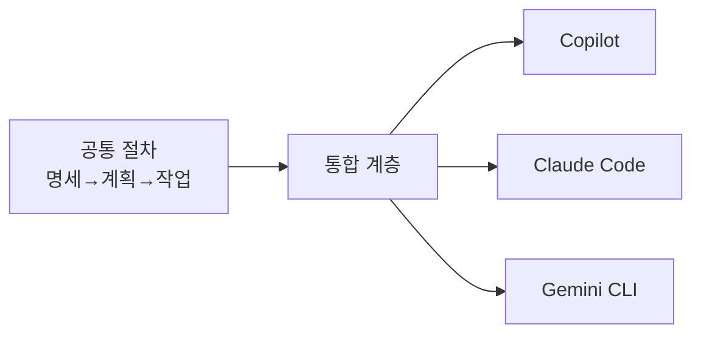
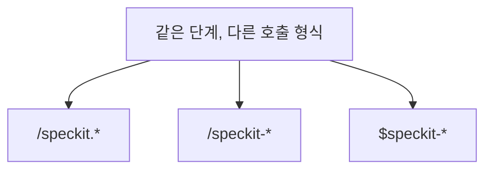

# 에이전트 통합(integration)

> 하나의 작업 절차(예: 명세 기반 개발)를 **Copilot·Claude Code·Gemini CLI 등 여러 코딩 에이전트에 같은 방식으로 붙이는** 설정 계층.

## 쉽게 말하면
같은 레시피 카드를 한식·양식·일식 주방마다 각자 쓰는 양식으로 바꿔 꽂아 주는 어댑터다. 요리사(에이전트)가 달라도 같은 순서로 요리한다.

## 자세히
(검색 요약 기준. GitHub Spec Kit 공식 문서가 중심이며, 일부 출처는 커뮤니티 포크다.)
- Spec Kit 공식 통합 참조 페이지는 약 **30개 통합**을 나열한다(Kilo Code, Oh My Pi, opencode 등). 다른 가이드는 2026-09-14 기준 50개 이상이라고 하고 오래된 미러는 "15+"라 하므로 숫자는 공식 참조 페이지로 확인해야 한다.
- 명령 형식이 에이전트마다 다르다: 대부분 `/speckit.*`, Copilot의 기본 스킬 모드는 `/speckit-*`, Codex 등은 `$speckit-*`, Kimi는 `/skill:speckit-*`.
- Copilot은 기본 구성: `specify init --ai copilot`으로 Copilot Chat에서 `/speckit.*` 명령을 인식하게 한다(Microsoft Learn 모듈 기준). Claude Code·Gemini CLI 지원은 커뮤니티 목록에서 확인되나 공식 디렉터리는 직접 확인하지 못했다.
- 제한: Amazon Q Developer CLI는 슬래시 명령의 사용자 정의 인자를 지원하지 않는다.
- 확인 방법: 설치된 버전에서 `specify integration list`.
- 의미: 절차(명세→계획→작업)는 한 번 정의하고, 에이전트별 차이는 통합 계층이 흡수한다.

## 그림으로 보기

## 예시
- 팀이 서로 다른 에이전트를 써도 같은 `/speckit.specify`로 명세부터 시작.
- 교육: 도구가 바뀌어도 절차는 유지하는 "표준 작업 절차" 설계 사례.

## 헷갈리는 것과 비교
| 개념 | 차이 |
|---|---|
| 통합 | 한 절차를 여러 에이전트에 설치 |
| 플러그인 | 에이전트 기능 확장 |
| [SDD](#spec-as-source-of-truth) | 이 절차가 따르는 방법론 |

## 더 읽을거리
- [Spec Kit: Supported Integrations](https://github.github.com/spec-kit/reference/integrations.html) — 공식 참조(검색 결과 확인).
- [Microsoft Learn: Spec Kit 모듈](https://learn.microsoft.com/en-us/training/modules/spec-driven-development-github-spec-kit-enterprise-developers/3-examine-github-spec-kit) — Copilot 구성.
