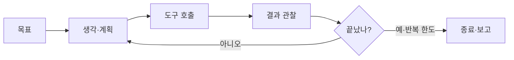
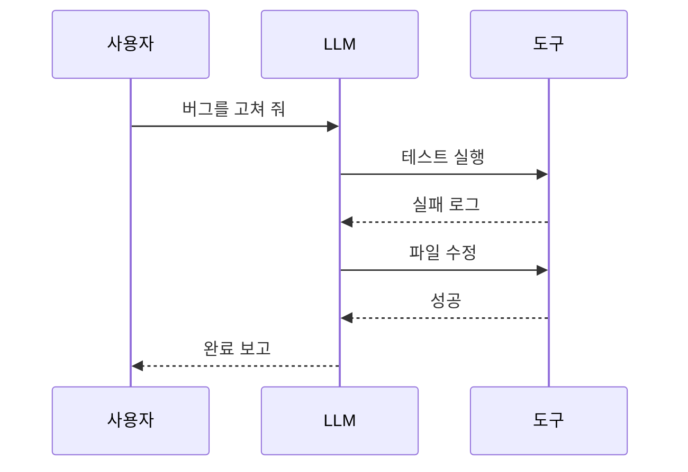

# 에이전트 루프

> LLM이 "생각 → 도구 사용 → 결과 확인"을 목표에 닿을 때까지 되풀이하는 구조. 에이전트의 가장 작은 단위다.

## 쉽게 말하면
길을 모르는 운전자가 내비를 보며 가는 모습이다. 한 번에 도착지를 맞히지 않고, 조금 가 보고(도구 사용), 지금 위치를 확인하고(관찰), 다음 방향을 정한다(생각). 도착하거나 "그만" 신호가 올 때까지 반복한다.

## 자세히
Anthropic "Building effective agents" 설명 기준:
- 에이전트는 "환경 피드백을 받으며 도구를 쓰는 LLM이 루프를 도는 것"에 가깝다.
- **시작**: 사용자의 명령이나 대화로 과제가 명확해지면 스스로 계획하고 움직인다. 정보나 판단이 필요할 때만 사람에게 돌아온다.
- **매 단계**: 모델이 도구 사용 블록을 응답에 넣어 호출 → 도구 결과(코드 실행, 검색 결과 등)가 "ground truth"로 돌아와 다음 판단의 근거가 된다.
- **멈춤**: 과제 완료, 또는 최대 반복 횟수 같은 **종료 조건**. 막히면 체크포인트에서 사람 확인을 받는다.
- **위험**: 비용이 늘고 오류가 누적될 수 있다. 샌드박스 테스트와 가드레일이 필요하다.
- **도구 설계가 절반**: 도구 설명을 주니어 개발자용 docstring처럼 쓰고 예시·경계를 적는다. 실수하기 어렵게 만든다(예: 절대 경로만 받게 하자 상대 경로 오류가 사라짐 — 원문의 SWE-bench 사례).

## 그림으로 보기

## 예시
- 코딩 에이전트: 코드 읽기 → 수정 → 테스트 실행 → 실패하면 다시 수정.
- 안전장치 프롬프트: "최대 10번 시도하고, 막히면 이유를 적어 나에게 물어봐."

## 헷갈리는 것과 비교
| 개념 | 차이 |
| --- | --- |
| 에이전트 루프 | 한 에이전트의 반복 구조 |
| [워크플로](#workflow-vs-agent) | 경로가 미리 정해짐. 루프를 쓰더라도 사람이 설계 |
| [LangGraph](#langgraph) | 루프를 "되돌아가는 엣지"로 명시해 그림 |
| [하네스](#harness) | 루프를 감싸는 도구·권한·검증 환경 |

## 더 읽을거리
- [Building effective agents (Anthropic)](https://www.anthropic.com/research/building-effective-agents) — 루프·종료 조건·도구 설계
