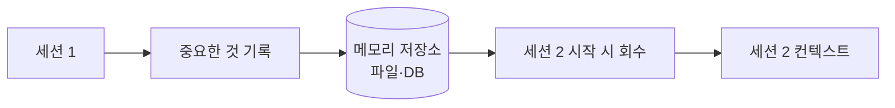
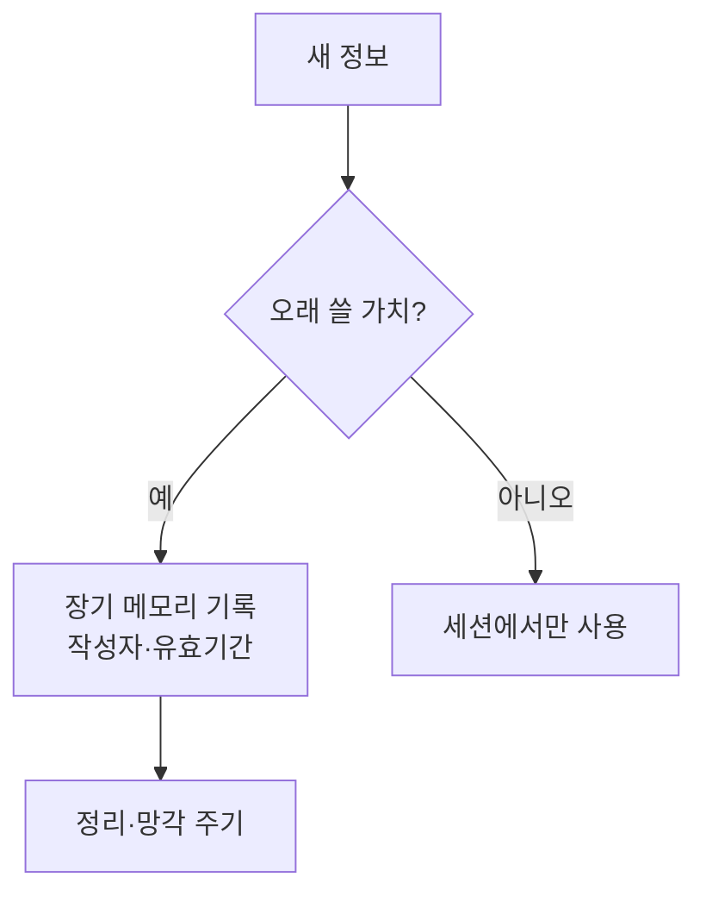

# 에이전트 메모리

> 에이전트 메모리는 대화(세션)가 끝나도 사실·선호·작업 경과를 남겨 다음에 다시 불러 쓰는 저장·회수 구조다.

## 쉽게 말하면
기억이 매번 지워지는 비서에게는 매일 아침 같은 설명을 해야 한다. 메모장(파일)에 중요한 것을 적어 두고 출근하면 읽고 시작하게 하는 것이 에이전트 메모리다. 모델 자체가 기억하는 게 아니라 **바깥에 적어 두고 다시 읽는** 방식이다.

## 자세히
- **모델은 상태가 없다**: 매 호출은 컨텍스트 창에 들어간 것만 본다. 그래서 기억은 외부 저장소(파일·DB)에 두고 필요할 때 컨텍스트에 주입한다.
- **종류(일반 분류)**: 단기(현재 세션 기록), 장기(사실·선호·결정), 절차 기억(어떻게 하는지: AGENTS.md 같은 지침), 작업 진행 로그.
- **가장 단순한 방식**: 마크다운 파일 + 검색(grep). 지식 기반 논의(2026-11-09 GeekNews 요약, 원문 미확인)에서도 "AGENTS.md + 지식 디렉터리 + grep이 가장 단순"이라는 반응이 우세했다. 주입한 메모리는 토큰을 쓰고, MEMORY.md는 앞부분(200줄/25KB)만 로드된다는 언급도 있었다.
- **표준화 논쟁**: LoreKit은 OpenTelemetry처럼 공통 레코드(범위·정체성·내용·유효기간·작성 주체)와 적합성 테스트를 제안했다(주장). 반론은 시기상조라는 것. MCP는 호출 표준이지 메모리 레코드 표준은 아니다.
- **위험**: 오래된 메모리(유효기간·망각 정책), 공유 메모리가 [프롬프트 주입](#prompt-injection) 경로가 되는 문제 — 작성 주체 기록으로 완화하나 완전 방어는 불가.

## 그림으로 보기

## 예시
- Claude Code의 `CLAUDE.md`/`AGENTS.md`: 프로젝트 규칙을 파일로 두고 매 세션 시작 때 읽힌다.
- 진행 파일: `progress.md`에 "끝난 것·다음 할 것"을 적어 다음 세션이 이어받게 한다.

## 헷갈리는 것과 비교
| 개념 | 차이 |
|---|---|
| 에이전트 메모리 | 세션을 넘는 외부 기록 |
| [컨텍스트 창](#context-window) | 한 번에 보는 작업 공간(휘발) |
| [RAG](#rag) | 문서 검색 보강, 메모리는 에이전트 자신의 경험 기록 |
| [AGENTS.md](#agents-md) | 사람이 쓰는 고정 지침(메모리의 한 형태) |

## 더 읽을거리
- [LoreKit 논의 요약(GeekNews)](https://news.hada.io/topic?id=36817) — 에이전트 메모리 공통 형식 제안과 반응(원문은 확인하지 못함).
