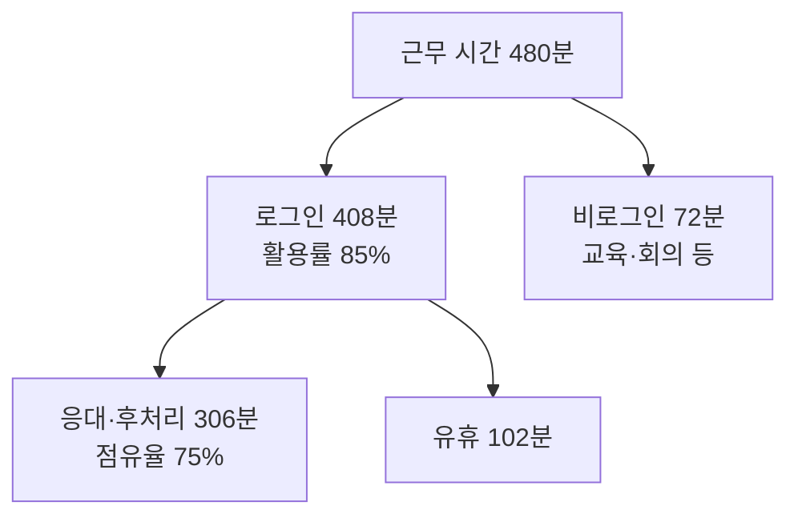
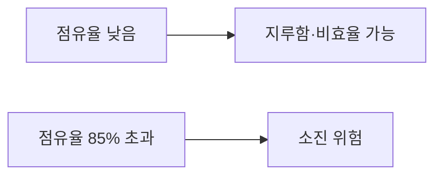

# 상담사 활용률

> 상담사 활용률은 상담사의 시간이 얼마나 쓰였는지 보는 지표다. 용어가 둘로 갈린다. 점유율(occupancy)은 로그인한 시간 중 실제 응대·후처리에 쓴 비율이고, 활용률(utilization)은 전체 근무 시간 중 로그인해 있는 비율이다. 출처마다 이름을 섞어 쓰므로 정의부터 확인한다.

## 쉽게 말하면
식당 직원이 홀에 서 있는 시간(로그인) 중에 실제로 손님을 응대한 시간이 점유율이고, 근무 시간 전체 중 홀에 서 있었던 시간이 활용률이다. 점유율이 너무 높으면 쉴 틈이 없어 지치고, 너무 낮으면 놀고 있는 시간이 많다.

## 자세히
- **점유율(Call Centre Helper, 열람)**: (처리 시간 ÷ 로그인 시간) × 100. 통화·보류·후처리를 처리 시간에 포함한다. 보통 목표는 80~85%이고 85%를 넘으면 소진 위험이 있다고 한다. 범용 최적 기준은 없고 예산과 직원 복지의 균형으로 정한다. 점유율은 일정 설계와 Erlang 기반 인력 계산에 쓰는 계획 지표이며 상담사 개인 목표가 아니라 센터 전체로 측정하라고 한다.
- **활용률(같은 글)**: (로그인 시간 ÷ 총 근무 시간) × 100. 교육·회의·코칭·시스템 중단 같은 내부 슈링키지를 포함하고, 유급 휴식·결근·지각 같은 외부 슈링키지는 분모에 넣지 않는다고 설명한다. 활용률은 간접비와 [슈링키지](#shrinkage-rate) 계산에 쓰인다. 이 글은 활용률 목표를 제시하지 않는다.
- **정의가 섞이는 이유**: ICMI 글(열람)은 점유율을 통화·후처리·콜 사이 업무·회의·유급 휴식·교육까지 "점유된" 시간으로 넓게 정의하고 휴가·병가와 다음 통화를 기다리는 유휴 시간은 제외한다. 즉 같은 "점유율"이라도 어디까지 포함하는지가 글마다 다르다. 이 글은 "소진과 지루함 사이의 균형을 가늠하는 지표"라고 쓴다. 검색 결과 요약에서는 활용률 목표를 75~85%(TechTarget) 등 출처마다 다르게 제시하고 85% 초과를 소진과 연결했다(요약만 확인).
- **가상 계산(직접)**: 8시간(480분) 근무에 로그인 408분, 이 중 응대·후처리 306분이면 활용률 408÷480 = 85%, 점유율 306÷408 = 75%다. 두 값이 다른 질문에 답하므로 같이 본다.
- **AI 도입과의 관계(해석)**: AI가 쉬운 문의를 먼저 처리하면 상담사에게 오는 문의는 더 어렵고 길어져, 건수는 줄어도 건당 처리 시간이 늘 수 있다. 점유율은 건수가 아니라 시간으로 보므로 도입 전후를 비교하기 좋다. 점유율이 소진 구간으로 올라가지 않는지 점검한다.
- **한계**: 한 가지 지표로 판단하지 않는다. 점유율이 낮은 것이 반드시 비효율은 아니다. 변동하는 도착에 대비한 대기 시간이 필요하다(해석).

## 그림으로 보기

## 예시
- AI 챗봇 도입 후 상담사의 점유율이 75%에서 88%로 올랐다면, 쉬운 건이 사라져 어려운 건만 남은 신호일 수 있어 인력과 교육을 조정한다.
- 교육 활용: 자기 하루 시간표로 활용률과 점유율을 각각 계산해 두 값이 다른 이유를 설명하는 연습.

## 헷갈리는 것과 비교
| 개념 | 차이 |
| --- | --- |
| 점유율(occupancy) | 로그인 시간 중 응대에 쓴 비율 |
| 활용률(utilization) | 근무 시간 중 로그인한 비율(출처에 따라 이름이 섞임) |
| [슈링키지](#shrinkage-rate) | 응대할 수 없는 시간의 비율 |
| [건당 처리 비용](#handling-time-cost) | 상위 주제. 처리 시간 × 단가 |

## 더 읽을거리
- [Call Centre Helper: Difference between occupancy and utilisation](https://www.callcentrehelper.com/difference-occupancy-utilisation-132518.htm) — 두 지표의 공식·목표
- [ICMI: Constructive use of occupancy](https://www.icmi.com/resources/2012/constructive-use-of-occupancy) — 점유율 정의와 사용 조언
