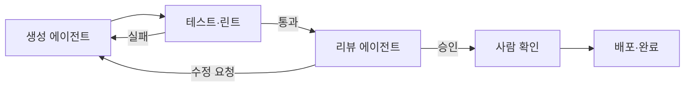
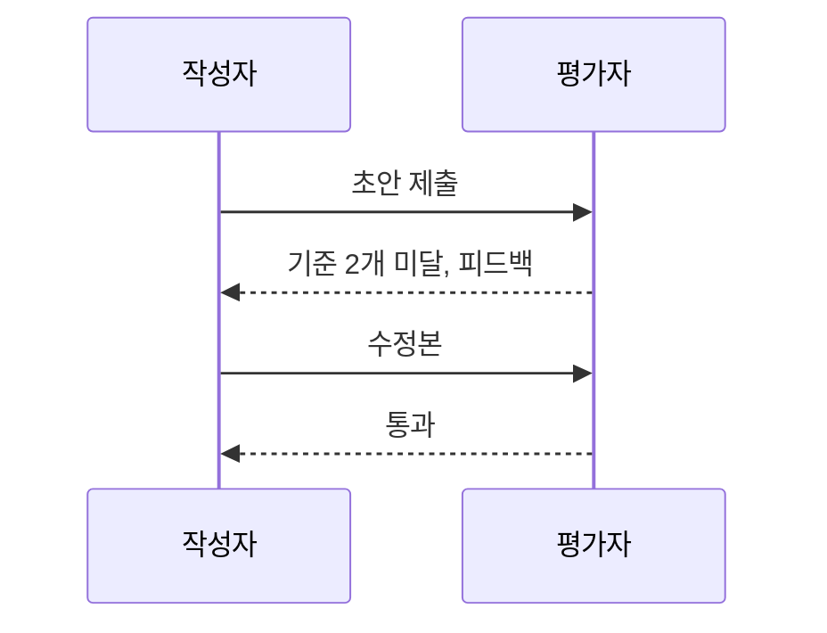

# 에이전트 검증 루프

> 에이전트가 낸 결과를 테스트·린트·리뷰어 모델 같은 별도 단계로 점검하고, 통과할 때까지 되돌려 고치게 하는 구조.

## 쉽게 말하면
글쓴이가 쓰고 편집자가 빨간 펜을 넣어 돌려주면 다시 고치는 출판 과정과 같다. "다 했어요"라는 말이 아니라 "시험을 통과했다"는 증거로 끝났음을 판단한다.

## 자세히
Anthropic "Building effective agents" 기준:
- **ground truth**: 에이전트는 매 단계 환경에서 실제 결과(도구 출력, 코드 실행 결과)를 받아 진행 상황을 판단해야 한다. 자기 느낌이 아니라 외부 신호.
- **코드는 검증 루프에 잘 맞는다**: 자동 테스트로 정답 여부를 확인할 수 있고, 에이전트가 결과를 보고 반복한다. 단 테스트가 통과해도 시스템 전체 요구사항 확인은 사람 리뷰가 필요하다.
- **Evaluator-optimizer 패턴**: 한 LLM 호출이 생성, 다른 호출이 평가·피드백, 루프로 반복. 평가 기준이 명확하고 반복이 실제로 품질을 올릴 때 적합.
- **안전장치**: 최대 반복 횟수 같은 종료 조건, 막혔을 때 사람 체크포인트, 샌드박스 테스트(오류가 단계마다 누적될 수 있음).
- 흔한 게이트: 단위 테스트 → 린트·타입 검사 → 리뷰 에이전트 → 사람 승인. 앞 단계일수록 싸고 빠르다.
- 주의: 생성자와 평가자가 같은 모델·같은 맥락이면 같은 맹점을 공유할 수 있다(독립 맥락, 다른 모델 사용 고려).

## 그림으로 보기

## 예시
- 프롬프트: "수정 후 `npm test`와 린트를 돌리고, 실패하면 원인을 고쳐 다시 돌려. 최대 5번, 그래도 안 되면 멈추고 보고해."
- 번역 파이프라인: 번역 → 평가자가 뉘앙스 누락 지적 → 재번역.

## 헷갈리는 것과 비교
| 개념 | 차이 |
| --- | --- |
| 검증 루프 | 실행 중 결과를 점검하고 되돌림 |
| [평가(eval)](#ai-evaluation) | 시스템 전체를 사전/사후에 측정 |
| [LLM 심사위원](#llm-as-judge) | 평가자를 모델로 쓰는 기법, 검증 루프의 부품 |
| [에이전트 루프](#agent-loop) | 검증 루프를 감싼 더 큰 반복 |

## 더 읽을거리
- [Building effective agents (Anthropic)](https://www.anthropic.com/engineering/building-effective-agents) — evaluator-optimizer와 ground truth
