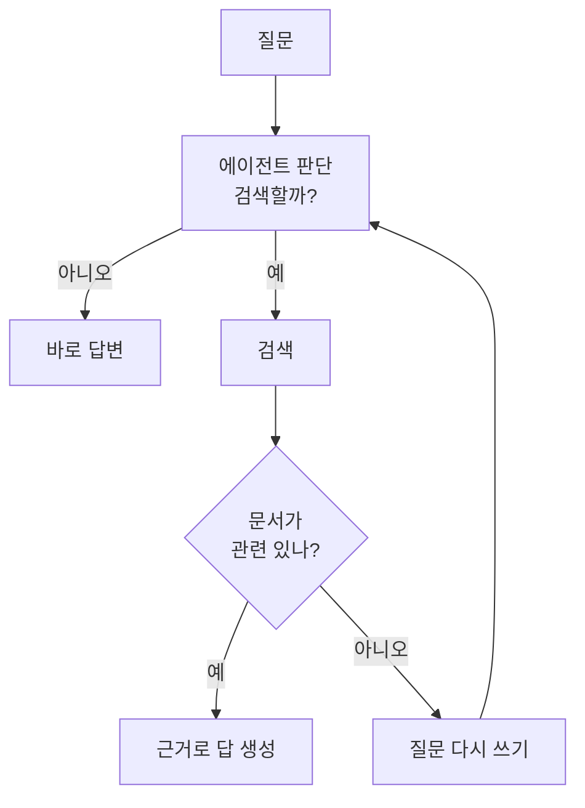
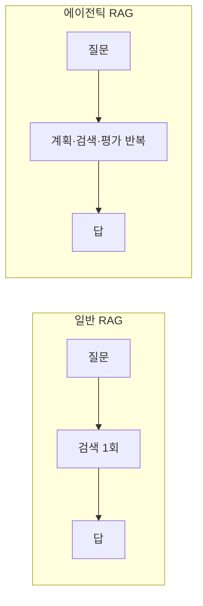

# 에이전틱 RAG

> 검색을 한 번 하고 끝내는 일반 RAG와 달리, 에이전트가 "검색할지 말지·무엇을 검색할지·결과가 쓸 만한지"를 스스로 판단하고 필요하면 질문을 고쳐 다시 검색하는 RAG.

## 쉽게 말하면
일반 RAG는 도서관 사서에게 키워드를 한 번 말하고 건네받은 책으로 답을 쓰는 방식이다. 에이전틱 RAG는 조사원이 직접 움직인다. 책을 받아 보고 "이건 엉뚱하네" 싶으면 검색어를 바꿔 다시 찾고, 한 곳에 없으면 다른 서고나 웹도 뒤진다. 이미 아는 질문엔 아예 찾지 않는다.

## 자세히
- **정의**: 서베이 논문(Singh 외, 2025년 1월)은 RAG 파이프라인에 자율 에이전트를 넣어 고정된 흐름과 약한 다단계 추론 문제를 풀려는 접근이라 정리한다.
- **네 가지 에이전트 패턴**: 성찰(reflection), 계획(planning), 도구 사용(tool use), 다중 에이전트 협업. 이를 통해 검색 전략을 바꾸고 흐름을 조정한다.
- **분류 축**: 에이전트 수(단일/다중), 제어 구조, 자율성 정도, 지식 표현 방식.
- **LangGraph 공식 튜토리얼의 기본 구조**(노드 5개): `generate_query_or_respond`(직접 답하거나 검색 도구 호출) → `retrieve`(검색) → 문서 채점(`grade_documents`, 관련성 판정) → 관련 있으면 `generate_answer`, 없으면 `rewrite_question` 후 처음으로 돌아가 재검색.
- **장점**: 복합 질문·애매한 질문에서 재시도로 회복한다.
- **대가**: 호출이 늘어 지연·비용이 커지고, 무한 루프 방지용 최대 횟수 제한이 필요하다. 서베이는 평가, 조정, 메모리 관리, 효율, 거버넌스를 미해결 과제로 꼽는다.
- **주의**: 단순 질의에는 일반 RAG가 더 싸고 빠르다([단순한 해법부터](#simplest-solution-first)).

## 그림으로 보기

## 예시
- 사내 질문 "작년 3분기 영업팀 비용 증가 원인?" — 에이전트가 재무 DB와 회의록을 각각 검색하고, 한 쪽 결과가 부실하면 검색어를 바꿔 다시 찾아 종합한다.
- 고객 문의 봇: 인사말엔 검색 없이 답하고, 정책 질문일 때만 검색한다.

## 헷갈리는 것과 비교
| 개념 | 차이 |
|---|---|
| [RAG](#rag) | 검색→생성 고정 흐름. 에이전틱은 판단·반복이 추가됨 |
| [하이브리드 검색](#hybrid-search) | 검색 방식을 섞는 것. 에이전틱은 검색 과정을 제어함 |
| [에이전트 루프](#agent-loop) | 일반적인 행동-관찰 반복. 에이전틱 RAG는 그 루프를 검색에 적용 |

## 더 읽을거리
- [Agentic Retrieval-Augmented Generation: A Survey (arXiv 2501.09136)](https://arxiv.org/abs/2501.09136) — 패턴·분류·과제
- [LangGraph Agentic RAG 튜토리얼](https://docs.langchain.com/oss/python/langgraph/agentic-rag) — 노드·조건 간선 구현
