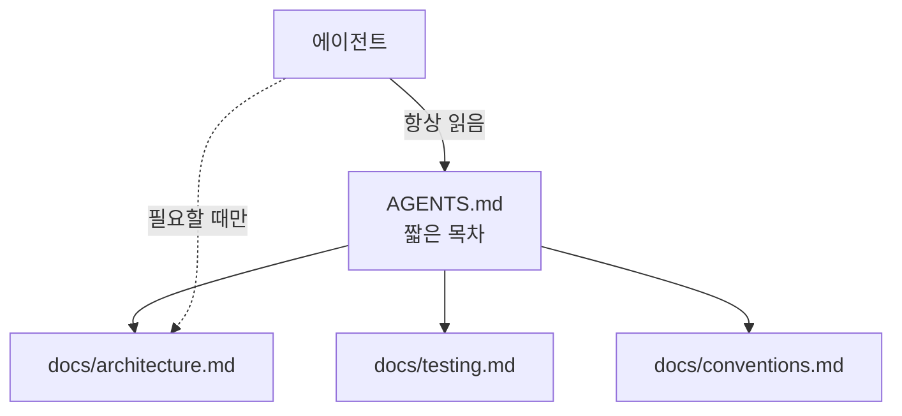

# AGENTS.md와 기록 시스템

> 코딩 에이전트가 프로젝트에 들어올 때 가장 먼저 읽는 "에이전트용 README". 빌드·테스트 명령과 규칙을 적고, 상세 문서는 별도 docs로 연결한다.

## 쉽게 말하면
신입 개발자에게 주는 입사 첫날 안내문이다. 어디에 무엇이 있고, 테스트는 어떻게 돌리고, 하면 안 되는 일이 무엇인지 한 장에 적는다. 모든 세부사항을 안내문에 담지 않고, 자세한 건 "이 폴더를 보라"고 가리킨다.

## 자세히
agents.md 공식 사이트 기준:
- 형식은 일반 Markdown이며 필수 항목이 없다. README는 사람용, AGENTS.md는 에이전트용으로 분리한다.
- 넣을 것: 프로젝트 개요, **빌드·테스트 명령**, 코드 스타일, 보안 주의, 커밋·PR 규칙, 배포 절차.
- 모노레포는 하위 폴더에 따로 둘 수 있고 **편집 중인 파일에 가장 가까운 것이 우선**이다. 사용자의 채팅 지시는 모두에 우선한다.
- Codex, Cursor, VS Code, Gemini CLI, Aider 등이 읽는다. Claude Code는 `CLAUDE.md`를 쓰므로 한쪽을 다른 쪽에서 참조하게 하는 식으로 맞춘다.
- 설계 원칙([컨텍스트 엔지니어링](#context-engineering)): 이 파일은 짧은 **목차**로 두고(항상 컨텍스트에 로드되기 때문), 세부는 docs/에 두어 필요할 때만 읽게 한다. 이렇게 repo 안의 문서를 에이전트의 "기록 시스템(system of record)"으로 삼는다.
- 파일이 길수록 규칙이 무시되기 쉽다. 반복해서 어기는 규칙만 남기고 나머지는 줄인다.

## 그림으로 보기


## 예시
```markdown
# AGENTS.md
## 명령
- 설치: pnpm install / 테스트: pnpm test (통과해야 완료)
## 규칙
- .env는 읽지 않는다. DB 마이그레이션은 사람 승인 후.
## 상세: docs/ 참고
```

## 헷갈리는 것과 비교
| 개념 | 차이 |
| --- | --- |
| README.md | 사람 기여자용 소개 |
| AGENTS.md | 에이전트용 지침(여러 도구가 읽음) |
| CLAUDE.md | Claude Code용 지침 파일 |
| 시스템 프롬프트 | 도구 제공사가 넣는 고정 지시 |

## 더 읽을거리
- [AGENTS.md](https://agents.md) — 형식·포함 항목·우선순위 규칙
- [Best practices for Claude Code](https://code.claude.com/docs/en/best-practices) — 지침 파일과 강제 규칙
