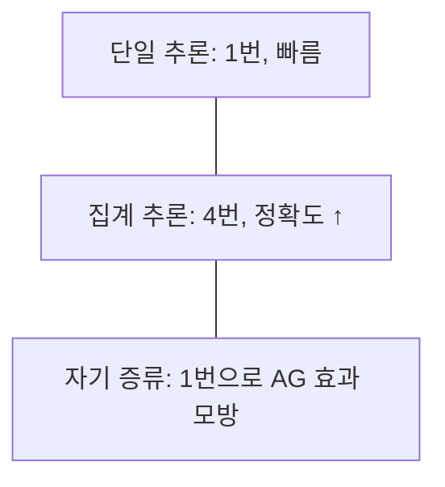

# 집계 추론

> 결합 라벨로 학습한 모델은 시험 이미지를 **회전 4가지로 돌려 각각 예측한 뒤 평균**낼 수 있다. 한 모델로 앙상블(여러 모델 합치기)에 가까운 정확도를 얻는 방식이다(SLA+AG).

## 쉽게 말하면
같은 문제를 의사 한 명이 네 가지 각도에서 보고 의견을 평균내는 것과 같다. 각도마다 정답 칸이 따로 있어서 "이 각도에서는 이 칸을 본다"는 규칙으로 의견을 모은다.

## 자세히
- 출처: Lee et al., *Self-supervised Label Augmentation via Input Transformations*(ICML 2020, arXiv 1910.05872v2). [결합 라벨 분포](#joint-label-distribution)로 학습한 모델이 전제다.
- 방법(논문 3장): 시험 샘플 x를 변환 t_j(j=1..M, 회전 4종)로 바꾼 x̃_j에 대해 **어떤 변환이 적용됐는지 이미 아니까** 전체 N×M 라벨을 볼 필요 없이 조건부 확률 P(i | x̃_j, j)만 쓴다. 이를 M개 변환에 걸쳐 합치되, **소프트맥스 이전의 로짓(logit)을 먼저 평균**한 뒤 소프트맥스를 취한다: P_aggregated(i|x) = softmax(s_i), s_i = (1/M)·Σ_j w_ij·z̃_j.
- 단일 추론(SI): 변환 없는 원본 x̃_1 하나만 쓴다. 집계(AG)는 모델을 M번(여기선 4번) 돌려야 하므로 **추론 비용이 M배**다.
- 결과(논문 Table 2, 정확도 %): 
  | 데이터셋 | 기준선 | SLA+AG | 독립 앙상블 4모델(IE) | IE+SLA+AG |
  |---|---|---|---|---|
  | CIFAR-10 | 92.39 | 94.50 | 94.36 | 95.10 |
  | CIFAR-100 | 68.27 | 74.14 | 74.82 | 76.40 |
  | tiny-ImageNet | 63.11 | 66.95 | 68.18 | 69.01 |
  - 읽는 법: 한 모델 집계(SLA+AG)가 CIFAR-10에서는 4모델 앙상블보다 약간 높고(94.50 vs 94.36), CIFAR-100·tiny-ImageNet에서는 약간 낮다. 논문은 이를 "독립 모델 여러 개와 비슷한 성능"이라 표현한다. 표에 따르면 단일 모델은 0.46M, 독립 4모델은 1.86M 파라미터다.
- 비용 문제는 [SLA 자기 증류](#self-distillation-sla)로 줄이려 한다(논문 제안).
- 한계: 결과는 논문이 보고한 작은 모델·특정 데이터셋 기준이다. 회전된 이미지가 의미를 가지는 데이터(문자 방향 등)에서는 적용을 검토해야 한다(추정).

## 그림으로 보기



## 예시
```python
outputs = model(rotated_inputs)         # 4배 배치
AG = sum(outputs[k::4, k::4] for k in range(4)) / 4
```
- 교육: "한 모델로 앙상블 효과"라는 아이디어 소개(테스트 시 증강, TTA와 비교).

## 헷갈리는 것과 비교
| 개념 | 차이 |
|---|---|
| 집계 추론(SLA+AG) | 한 모델·변환별 라벨 칸을 합침 |
| 독립 앙상블 | 서로 다른 모델 여러 개의 예측 평균 |
| 테스트 시 증강(TTA) | 보통 같은 라벨 칸의 예측을 평균(변환별 칸 없음) |
| [SLA 자기 증류](#self-distillation-sla) | 집계 효과를 단일 추론으로 옮김 |

## 더 읽을거리
- [Self-supervised Label Augmentation via Input Transformations (arXiv 1910.05872)](https://arxiv.org/abs/1910.05872) — 3장·Table 2(읽음).
