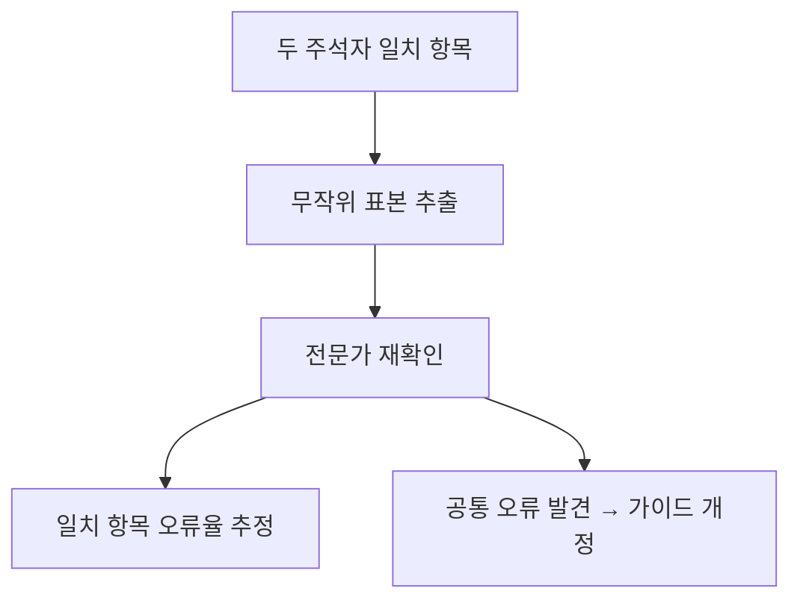
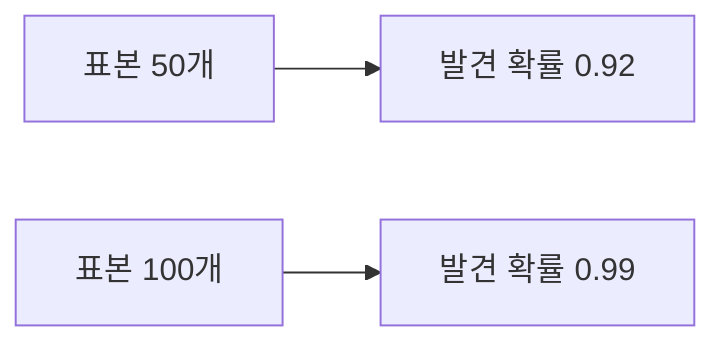

# 일치했지만 틀린 항목 표본 검수

> 일치했지만 틀린 항목 표본 검수는 두 주석자가 같은 라벨을 붙여 "합의"로 처리된 샘플 중 일부를 무작위로 뽑아 전문가가 다시 확인해, 공통 오류(둘 다 같은 이유로 틀린 경우)의 비율을 추정하고 잡아내는 점검이다.

## 쉽게 말하면
두 채점자의 점수가 같다고 해서 채점 기준이 맞다는 보장은 없다. 점수가 같은 답안지도 몇 장 뽑아 교수가 다시 보면, 두 사람이 같은 오해를 하고 있었는지 알 수 있다.

## 자세히
- **왜 필요한가**: 이중 검수에서는 불일치 샘플만 전문가에게 가므로 "둘 다 같은 오답"은 아무도 다시 보지 않는다([합의된 오답](#agreed-wrong-labels), [이중 검수](#double-annotation-review)). 주석자가 같은 가이드·편향을 공유하면 이런 오류가 늘어난다([주석자 공통 편향](#shared-annotator-bias); Geva 외, arXiv 1908.07898은 소수 작업자가 데이터 대부분을 만들 때 다양성이 위협받는다고 지적).
- **직접 시뮬레이션(가정: 항목의 3%에서 두 검수자가 같은 오해로 같은 오답을 내고, 나머지는 각자 90% 정확도로 독립 판정, 10만 항목)**: 일치율 82.5%, 일치 항목 중 오답은 약 5.0%(전체의 4.1%)였다. 일치 항목에서 m개를 무작위로 뽑아 전문가가 보면 오류를 하나 이상 찾을 확률은 m=50일 때 0.921, m=100일 때 0.994, m=200 이상은 거의 1이다. 즉 100개 정도의 표본으로도 이런 수준의 공통 오류는 거의 확실히 드러난다. (가정이 단순한 한 번의 시뮬레이션이며, 공통 오류율이 0.3%처럼 낮으면 필요한 표본이 훨씬 커진다.)
- **표본 설계(해석)**: ① 일치 항목에서 무작위 추출 ② 모델이 "라벨이 다르다"고 강하게 예측하는 일치 항목을 우선 포함(층화) ③ 공통 오류가 발견되면 가이드를 고치고 같은 유형의 일치 항목을 집중 재점검 ④ 점검 결과로 일치 항목의 오류율을 추정해 보고한다.
- **오류율 보고(해석)**: 표본에서 전문가가 틀렸다고 본 비율이 곧 일치 항목의 추정 오류율이다. 표본이 작으면 신뢰구간이 넓다는 점도 함께 적는다.

## 그림으로 보기

## 예시
- 일치 항목 100개를 뽑아 전문가가 5개를 오류로 판정하면 일치 항목 오류율 추정은 5%다. 같은 유형(예: 반어법 문장)이 몰려 있으면 가이드에 반어법 규칙을 추가한다.
- 교육 활용: 두 학습자가 일치한 문장 중 일부를 교수자가 다시 라벨링해 "일치 ≠ 정답"을 확인한다.

## 헷갈리는 것과 비교
| 개념 | 차이 |
| --- | --- |
| 일치 항목 표본 검수 | 일치한 항목의 숨은 오류 점검 |
| 불일치 판정 | 일치하지 않은 항목을 전문가가 확정 |
| [합의된 오답](#agreed-wrong-labels) | 점검 대상이 되는 오류 유형 |
| [검수자 독립성](#reviewer-independence) | 공통 오류를 줄이는 사전 설계 |

## 더 읽을거리
- [Are We Modeling the Task or the Annotator? (arXiv 1908.07898)](https://arxiv.org/abs/1908.07898) — 주석자 편향과 데이터 다양성
- [cleanlab filter 문서](https://docs.cleanlab.ai/stable/cleanlab/filter.html) — 모델로 의심 라벨 후보 뽑기
