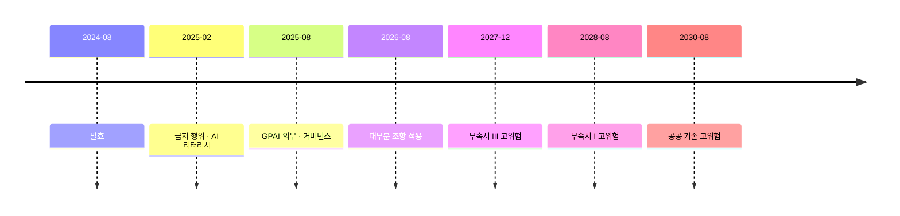

# AI Act 시행 일정

> EU AI Act는 2024-08-01 발효 후 단계적으로 적용된다. 금지 행위·AI 리터러시(2025-02), GPAI 의무(2025-08), 나머지 대부분(2026-08)이 먼저이고, 고위험 AI는 2027-12·2028-08로 밀려 있다(아래 출처 페이지 기준).

## 쉽게 말하면
신축 건물의 입주를 층별로 나눠 여는 것과 같다. 위험이 큰 것(금지 행위)부터 문을 닫고, 준비 시간이 필요한 고위험 시스템 규정은 나중에 적용한다.

## 자세히
출처: artificialintelligenceact.eu 구현 일정 페이지(2026-08-31 갱신본, 2026-11-15 확인). 공식 관보 원문 대조는 하지 않았으니 날짜는 최종 확인 필요. 이 페이지에는 "디지털 옴니버스" 지연 제안에 대한 언급이 없었고, 고위험 적용일은 원안(2026-08-02)보다 늦춰져 표기돼 있다.
- **2024-08-01** 발효.
- **2025-02-02** 금지 AI 관행 + AI 리터러시 의무 적용.
- **2025-08-02** GPAI 모델 의무, 거버넌스, 통지기관, 일부 과징금 규정 적용. 이미 시장에 있던 GPAI는 2027-08-02까지.
- **2026-08-02** 나머지 조항 적용(별도 명시 제외). 생성 AI 제공자의 기존 시스템은 50조 2항(표시 의무)을 2026-12-02까지.
- **2026-12-02** 비동의 성적 이미지·아동 성착취물 관련 금지 적용.
- **2027-08-02** 2025-08 이전 출시 GPAI 준수 기한, 회원국 AI 규제 샌드박스 1개 이상 가동.
- **2027-12-02** 부속서 III 고위험 시스템의 3장 1~3절 적용.
- **2028-08-02** 부속서 I(제품 안전 법령 연계) 고위험 시스템 적용, AI Office 평가.
- **2030-08-02** 공공기관이 쓰는 기존 고위험 시스템 준수.
- 과징금 구조는 [AI Act 과징금](#eu-ai-act-penalties) 참고.

## 그림으로 보기

## 예시
- 한국 기업이 EU에 챗봇 서비스 제공: 2026-08부터 투명성 의무(사용자에게 AI임을 알림) 준비, 기존 생성 AI 표시는 2026-12-02까지.
- 인사 평가 AI(부속서 III 고위험)는 이 페이지 기준 2027-12-02부터 의무 — 개발·문서화는 그 전에 시작.

## 헷갈리는 것과 비교
| 개념 | 차이 |
|---|---|
| 발효 | 법이 효력을 갖는 날 |
| 적용 | 의무가 실제 시작되는 날(단계별) |
| [GPAI 의무](#eu-ai-act-gpai) | 범용 모델 제공자 대상 |
| [고위험 AI](#eu-ai-act-high-risk) | 용도 기반 분류 |

## 더 읽을거리
- [AI Act Implementation Timeline](https://artificialintelligenceact.eu/implementation-timeline/) — 날짜별 적용 항목
