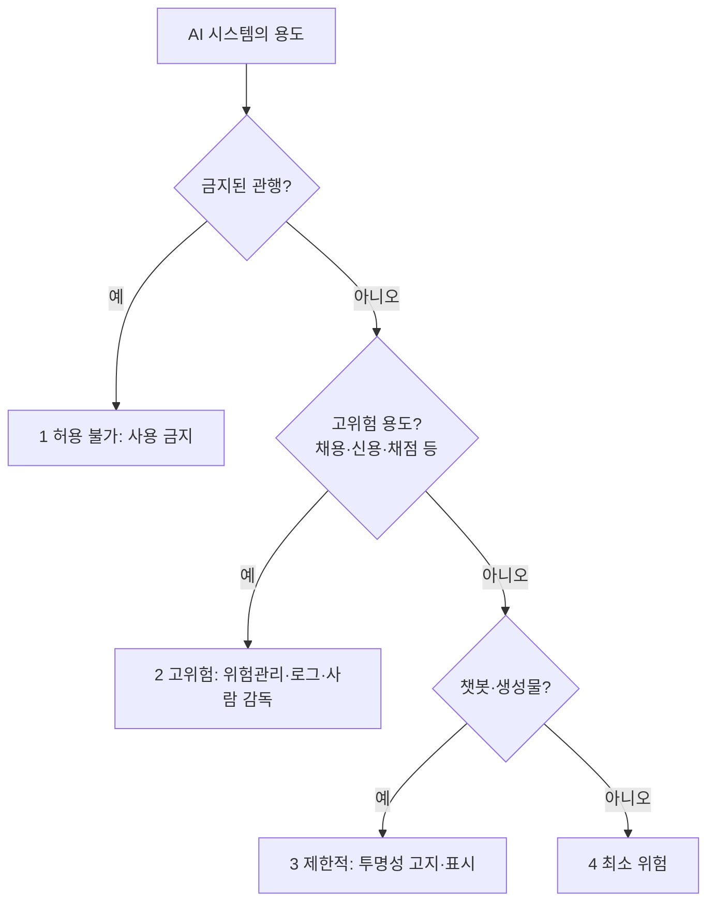
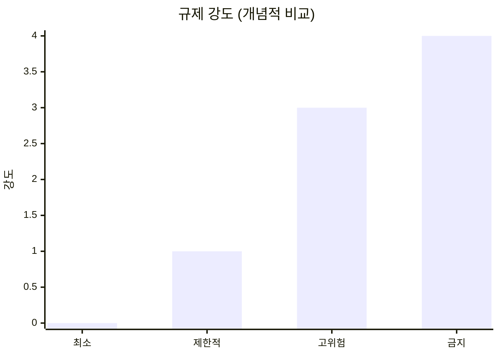

# AI Act 위험 등급

> EU AI Act는 AI를 **얼마나 위험한가에 따라 4단계로 나누어 규제 강도를 다르게** 한다: **금지(허용 불가)** → **고위험(엄격한 의무)** → **제한적 위험(투명성 의무)** → **최소 위험(별도 규칙 없음)**. 내 서비스가 어느 칸에 속하는지 아는 것이 규정 준수의 첫걸음이다.

## 쉽게 말하면
도로 규칙처럼 "절대 금지 구역", "면허·검사가 필요한 위험 구간", "표지판만 달면 되는 구간", "자유 통행 구간"으로 나눈 것이다. 같은 AI라도 쓰이는 용도에 따라 구간이 달라진다.

## 자세히
(유럽연합 집행위원회 AI 규제 프레임워크 페이지 요약, 2026-11-25 확인. 정확한 조항·날짜는 관보 원문 확인 필요)

| 단계 | 의미 | 예시(페이지 기준) | 핵심 의무 |
|---|---|---|---|
| 1 허용 불가(금지) | 9가지 관행 금지 | 사회적 점수화, 해로운 조작·취약성 악용, **직장·교육에서의 감정 인식** | 사용 금지 |
| 2 고위험 | 엄격한 의무 | 핵심 인프라의 안전 구성요소, **시험 채점**, **채용 이력서 분류**, **신용 평가**, 이민·국경 관리 도구 | 위험 관리, 데이터 품질, 로그 기록, 문서화, 사람의 감독, 견고성·사이버 보안 |
| 3 제한적 위험 | 투명성 | **챗봇**(사용자에게 기계와 대화 중임을 알려야 함), **딥페이크** 등 AI 생성 콘텐츠(식별·표시) | 고지·표시 |
| 4 최소 위험 | 특별 규칙 없음 | 스팸 필터, AI 게임 등 현재 쓰이는 대부분의 AI | 없음 |

- **적용 시점**(집행위 페이지): 2024-08-01 발효, **2025-02-02 금지 관행과 AI 리터러시 의무**, 2025-08-02 거버넌스와 범용 AI(GPAI) 모델 의무, **2026-08-02 투명성 규칙과 AI Office 집행 권한**, **2027-12-02 부속서 III 고위험**, 2028-08-02 규제 제품에 내장된 AI(부속서 I) 고위험. 'AI Omnibus' 개정이 고위험 기한을 늦췄다고 안내한다. 비동의 성적 콘텐츠·아동 성착취물 생성 AI(예: "누드화" 앱) 금지는 2026년 12월부터다(페이지 기준).
- **벌금**: 집행위 페이지는 AI Office가 위반 시 과징금을 부과할 수 있고 회원국 당국과 집행을 분담한다고만 안내하고 금액은 제시하지 않는다.
- **분류 연습**: 용도가 핵심이다. 같은 이미지 인식 기술이라도 "사진 정리"는 최소 위험, "채용 면접 감정 분석"은 직장 감정 인식이라 **금지** 영역에 걸릴 수 있다. 자체 사례는 법무 검토 필수.
- **교육 활용**: 기업 교육에서 "우리 팀의 AI 사용 사례를 4단계로 분류해 보기" 실습, 특히 인사·교육 평가 AI는 고위험일 수 있음을 짚기.
- 한계: 이 글은 법률 자문이 아니며, 법령 개정·해석이 계속 바뀐다. 한국 기업도 EU에 서비스를 제공하면 적용 대상이 될 수 있다.

## 그림으로 보기



## 예시
```python
def risk_tier(use_case: str) -> str:
    banned = {"사회적 점수화", "직장 감정 인식"}
    high = {"채용 이력서 분류", "신용 평가", "시험 채점"}
    limited = {"챗봇", "딥페이크 생성"}
    if use_case in banned: return "1 금지"
    if use_case in high: return "2 고위험"
    if use_case in limited: return "3 제한적(투명성)"
    return "4 최소 위험"
```
- 사내 AI 도구 목록을 표로 만들어 용도·등급·담당자·필요 조치를 적는 인벤토리가 출발점이다.

## 헷갈리는 것과 비교
| 개념 | 차이 |
|---|---|
| 위험 등급 | 용도 기준 4단계 분류 |
| [EU AI Act](#eu-ai-act) | 법 전체 개요 |
| [고위험 AI](#eu-ai-act-high-risk) | 2단계의 상세 의무 |
| [범용 AI 모델 의무](#gpai-obligations) | 모델 제공자에게 따로 적용되는 규칙 |

## 더 읽을거리
- [European Commission: AI Act — Regulatory framework for AI](https://digital-strategy.ec.europa.eu/en/policies/regulatory-framework-ai) — 4단계·타임라인.
