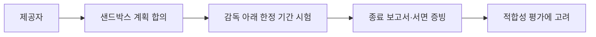
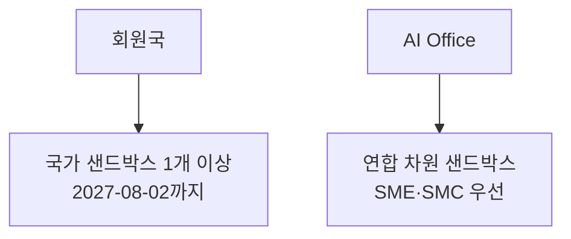

# AI 규제 샌드박스

> EU AI Act 57조가 회원국에 설치를 요구하는 통제된 시험 환경. 기업이 AI를 시장에 내기 전에 규제 당국의 지도·감독 아래 한정된 기간 시험하며, 위험을 찾고 준수 방법을 배운다.

## 쉽게 말하면
신약을 출시 전에 병원 감독 아래 시범 투여해 보는 것과 비슷하다. 규제 당국이 옆에서 기대 수준을 설명해 주고, 끝나면 시험 결과를 증빙해 준다.

## 자세히
출처는 artificialintelligenceact.eu의 57조(열람). 이 페이지에는 개정 문구가 섞여 있어 확정 문구는 관보로 확인해야 한다. 법률 자문이 아니다.
- **1항**: 회원국은 적어도 하나의 AI 규제 샌드박스를 두며 "2027-08-02까지 운영 가능"해야 한다(페이지에 이전 문구로 2026년 표기도 있음). 다른 회원국과 공동 설치할 수 있고, 기존 샌드박스 참여로 동등한 국내 범위가 확보되면 의무를 충족할 수 있다.
- **2·3항**: 지역·지방·공동 샌드박스를 추가로 둘 수 있고, EU 기관용으로 유럽 개인정보감독관(EDPS)이 설치할 수 있다. **3a항**: AI Office가 연합 차원 샌드박스(75조 1항 대상 AI)를 만들 수 있고 SME(스타트업 포함)와 소형 중견기업(SMC)에 우선 접근을 준다.
- **5·6항**: 시장 출시 전 한정된 기간 동안 제공자와 합의한 샌드박스 계획에 따라 통제된 환경을 제공하며, 감독 아래 실제 환경 시험을 포함할 수 있다. 당국은 특히 기본권·건강·안전 위험을 찾도록 지도·감독·지원한다.
- **7·8항**: 당국은 규제 기대치를 설명하고 요청 시 완료한 활동의 서면 증빙과 종료 보고서(exit report)를 발급한다. 시장 감시 당국과 인증기관은 적합성 평가를 빠르게 하는 데 이를 고려해야 한다. 집행위와 AI Board는 종료 보고서에 접근할 수 있고, 제공자와 당국이 합의하면 공개할 수 있다.
- **9항(목적)**: 법적 확실성, 모범 사례 공유, 혁신·경쟁력 지원, 증거 기반 규제 학습, 특히 SME·스타트업의 EU 시장 진입 가속.
- **10~12항**: 개인정보를 처리하면 개인정보 보호 당국 등이 감독에 참여한다. 샌드박스는 감독 권한을 제한하지 않고 중대한 위험을 완화할 수 없으면 시험·참여를 정지할 수 있다. 참여자는 제3자 피해에 대한 법적 책임을 지지만, 계획과 당국 지침을 선의로 따르면 행정 과징금이 부과되지 않는다.
- **15·16항**: 새 샌드박스는 AI Office와 Board에 통지하고 AI Office가 공개 목록을 유지한다. 설치 1년 뒤부터 연례 보고서를 제출하고 최종 보고서를 낸다. 연례 보고서는 온라인 공개.
- **17항**: 집행위가 이해관계자용 단일 정보 인터페이스를 만든다.
- 개정 합의에서도 샌드박스 설치 기한이 2027-08-02로 언급됐다([부속서 III 적용 연기](#annex-iii-delay)의 Sidley 글).

## 그림으로 보기

## 예시
- 의료 영상 AI 스타트업이 샌드박스에서 당국과 시험 계획을 합의하고 종료 보고서를 받아 이후 적합성 평가에서 참고 자료로 제출(가상 시나리오).
- 교육 실습: 자기 회사 AI 기능이 샌드박스에서 확인받고 싶은 "규제 질문" 3개를 적어 본다.

## 헷갈리는 것과 비교
| 개념 | 차이 |
|---|---|
| 규제 샌드박스 | 당국 지도 아래 시험하는 제도 |
| 실제 환경 시험 | 샌드박스에 포함될 수 있는 시험 방식 |
| 시장 출시 | 샌드박스 이후 단계 |
| [AI Board](#ai-board) | 샌드박스 조정에 참여하는 협의체 |

## 더 읽을거리
- [AI Act Article 57](https://artificialintelligenceact.eu/article/57/) — 샌드박스 조문(열람)
