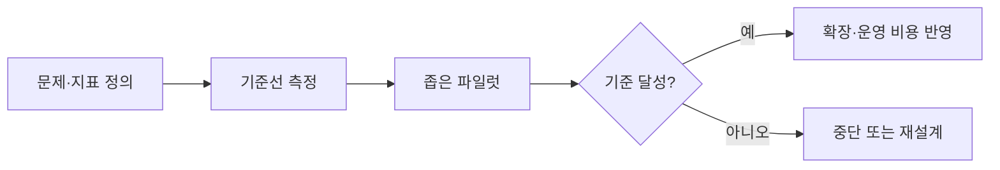

# AI 도입 ROI와 파일럿

> 조직이 AI를 작게 시범 도입(파일럿)해 효과를 숫자로 재고 확장하는 과정. 널리 쓰이지만 재무 성과로 이어진 곳은 아직 소수라는 조사가 많다.

## 쉽게 말하면
신메뉴를 전 매장에 내기 전에 한 매장에서 2주 팔아 보고, 매출·재료비·손님 반응을 재는 것과 같다. 시식회가 인기 있었다고 장사가 되는 건 아니다.

## 자세히
- **MIT NANDA 'GenAI Divide' 보고서(2025-07)**: 공개 AI 사례 300여 건 검토, 52개 조직 인터뷰, 설문 기반. 주장: "300~400억 달러 투자에도 95% 조직이 수익 0", 통합된 파일럿 중 5%만 가치 창출. 보고서 스스로 수치가 인터뷰·공개 자료에 근거하며 재무 감사가 아니라고 밝힌다 → **합의가 아닌 단일 보고서의 주장**으로 읽는다.
- 같은 보고서: 구매·제휴 도구의 배포 성공률 약 67% vs 자체 구축 약 33%(52개 조직 표본 기준).
- McKinsey State of AI 2025(검색 요약, 원문 미확인): 1,993명 응답, 88%가 한 기능 이상에서 AI 사용, EBIT 영향 보고는 39%(대부분 5% 미만). 폭넓은 도입, 좁은 재무 효과라는 방향은 두 자료가 같다.
- 파일럿 설계 요령: ① 측정할 지표(시간·건당 비용·오류율)와 기준선을 먼저 정한다. ② 업무 하나·팀 하나로 좁힌다. ③ 사람 확인 단계를 둔다. ④ 성공 기준과 중단 기준을 미리 적는다. ⑤ 확장 때 운영비(토큰·검수 인력)를 포함한다.

## 그림으로 보기

## 예시
고객 문의 요약 도구 파일럿: 상담사 20명, 4주. 기준선은 건당 처리 8분, 파일럿 후 6분이면 25% 단축. 단 검수 시간과 모델 비용을 빼고 순효과를 계산한다.

## 헷갈리는 것과 비교
| 개념 | 차이 |
| --- | --- |
| 파일럿(PoC) | 작게 검증, 확장은 별개 문제 |
| [자체 구축 vs 구매](#build-vs-buy-ai) | 파일럿 뒤 선택지 |
| 사용률 | 쓰는 사람 수일 뿐 ROI가 아님 |

## 더 읽을거리
- [State of AI in Business 2025 (MIT NANDA, PDF 사본)](https://mlq.ai/media/quarterly_decks/v0.1_State_of_AI_in_Business_2025_Report.pdf) — 95% 주장과 방법론 한계
