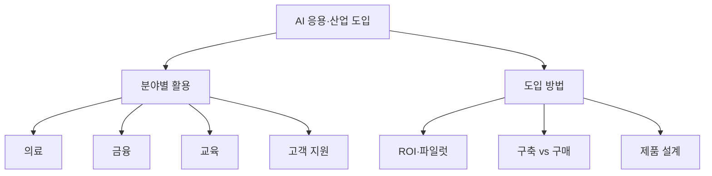

# AI 응용·산업 도입

> AI 기술이 의료·금융·교육·고객 지원 같은 실제 업무에 어떻게 들어가는지, 그리고 조직이 도입 효과를 어떻게 따지는지 다루는 큰 가지.

## 쉽게 말하면
다른 가지가 "엔진이 어떻게 생겼나"를 본다면, 이 가지는 "그 엔진을 어떤 차에 얹고 누가 운전하며 연비가 나오는가"를 본다. 같은 모델도 분야마다 규제와 위험이 다르다.

## 자세히
- **분야별로 달라지는 것**: 규제(의료는 FDA 기기 심사, 금융은 거절 사유 설명 의무, 교육은 EU AI Act 고위험), 오류 비용, 사람 확인 지점.
- **효과 근거의 질**: 무작위 시험·대규모 연구(고객 지원의 NBER 연구, 교육의 하버드·PNAS 연구)와 회사 발표(Klarna)는 신뢰도가 다르다. 이 가지의 글은 각 수치의 출처 등급을 밝힌다.
- **도입의 공통 질문**: 어떤 지표로 잴 것인가([ROI·파일럿](#ai-adoption-roi)), 만들지 살지([자체 구축 vs 구매](#build-vs-buy-ai)), 사람은 어디서 개입하나([AI 제품 설계](#ai-product-design)).
- 일반 통계: MIT NANDA 보고서는 파일럿 다수가 재무 성과로 이어지지 않는다고 주장한다(2025-07, 단일 보고서).

## 그림으로 보기

## 예시
고객 지원 팀이 "요약 + 답변 초안" 도구를 4주 파일럿하고, 처리 시간·재문의율을 기준선과 비교한 뒤 확장 여부를 정한다.

## 헷갈리는 것과 비교
| 개념 | 차이 |
| --- | --- |
| 이 가지 | 업무·산업에 적용, 도입 판단 |
| [AI 리터러시](#literacy) | 개인의 AI 이해·활용 능력 |
| [자동화](#automation) | 워크플로를 만드는 방법 자체 |

## 더 읽을거리
- [NBER: Generative AI at Work](https://www.nber.org/papers/w31161) — 고객 지원 현장 연구
- [EU AI Act Annex III](https://artificialintelligenceact.eu/annex/3/) — 분야별 고위험 용도
