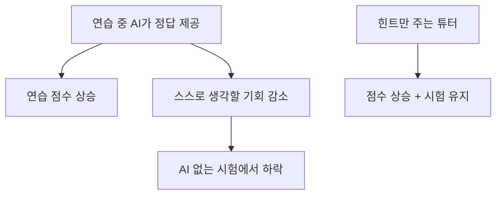

# AI 목발 효과

> AI 목발 효과는 연습 중 AI에 기대어 점수는 오르지만, AI가 사라진 시험에서 실력이 오히려 떨어지는 현상이다.

## 쉽게 말하면
다리를 다쳤을 때는 목발이 필요하지만 멀쩡한 다리로 계속 쓰면 근육이 약해진다. 연습 단계에서 AI가 답을 대신 걸어 주면, 정작 혼자 걸어야 할 때 힘이 없다.

## 자세히
- 근거 사례: Bastani 외(PNAS 2025)의 고등학교 수학 무작위 실험. 가드레일 없는 GPT-4(GPT Base) 사용 집단은 연습 점수가 +48% 올랐지만 AI 없는 시험에서 대조군보다 17% 낮았다. 저자들은 학생들이 연습 중 GPT-4를 목발처럼 썼기 때문이라고 해석한다.
- 힌트만 주도록 설계한 GPT Tutor 집단은 연습 +127%, 시험은 대조군과 비슷 → 해를 대부분 막았다.
- 주의: 한 과목·한 나라·단기 실험이다. 모든 AI 사용이 해롭다는 뜻이 아니라 **설계 없는 정답 제공**이 문제라는 증거로 읽는 게 안전하다.
- 대응: 힌트 단계화, 먼저 혼자 시도 규칙, AI 없는 점검 시험.

## 그림으로 보기

## 예시
신입이 AI로 보고서를 매번 완성하다가 AI를 못 쓰는 면접·현장 상황에서 쓰지 못하는 경우. 대책으로 "초안은 직접, AI는 피드백용"을 규칙화한다.

## 헷갈리는 것과 비교
| 개념 | 차이 |
|---|---|
| AI 목발 효과 | 연습 중 의존으로 시험 성과 하락 |
| [인지적 오프로딩](#cognitive-offloading) | 생각을 외부에 맡기는 일반 현상 |
| [생산적 어려움](#productive-struggle) | 목발이 없애 버리는 학습 요소 |
| [학습 vs 수행](#learning-vs-performance) | 이 효과를 설명하는 구분 |

## 더 읽을거리
- [SSRN: Generative AI Without Guardrails Can Harm Learning](https://papers.ssrn.com/abstract=4895486) — 원 연구 초록.
- [Wharton Knowledge](https://knowledge.wharton.upenn.edu/article/without-guardrails-generative-ai-can-harm-education) — 연구 해설.
