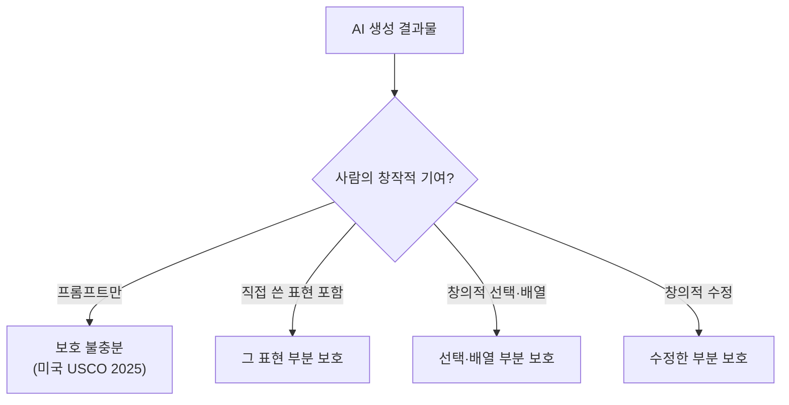

# AI 저작자 문제

> AI로 만든 결과물에 **저작권이 생기는가, 누구의 것인가**의 문제. 미국 저작권청(USCO)은 2025년 1월 보고서에서 **순수하게 AI가 만든 부분은 보호되지 않고, 사람의 창작적 기여(표현·선택·배열·수정)가 있는 부분만 보호된다**고 정리했다. 나라마다 규칙이 다르다.

## 쉽게 말하면
카메라로 사진을 찍으면 구도와 순간을 고른 사람이 저작자다. 그러나 "아름다운 풍경 그려 줘"라고 한 줄만 말하고 AI가 알아서 그린 결과는, 말한 사람이 표현을 통제했다고 보기 어렵다는 것이 현재 미국의 시각이다. 결과를 직접 고르고 배열하고 고쳐 쓴 만큼이 사람의 몫이 된다.

## 자세히
(U.S. Copyright Office, *Copyright and Artificial Intelligence, Part 2: Copyrightability*, 2025-01-29 발간 — 보고서 PDF의 요약 결론 직접 확인)
- 저작권 문제는 **기존 법으로 해결 가능**하며 입법이 필요하다는 근거는 아직 부족하다.
- AI를 사람의 창작을 **보조하는 도구**로 쓰는 것은 결과물의 저작권 보호 가능성에 영향을 주지 않는다.
- 사람이 만든 **독창적 표현**은 AI 생성물이 섞여 있어도 보호된다.
- **순수하게 AI가 만든 부분**, 또는 표현 요소에 대한 **사람의 통제가 불충분한** 부분은 보호되지 않는다.
- 현재 일반적으로 쓰이는 기술에서는 **프롬프트만으로는 충분한 통제가 되지 않는다**고 본다.
- 사람은 ① AI 결과물에서 **지각되는 자신의 창작 표현**, ② 결과물의 **창의적 선택·조정·배열**, ③ 결과물을 **창의적으로 수정**한 부분에 대해 권리가 있다.
- 충분한 기여인지는 **사례별로 판단**한다. 추가적인 AI 생성물 전용 보호(sui generis)는 필요성이 입증되지 않았다.
- **주의**: 위는 미국 기관의 입장이며 법원 판결이 아니다. 한국·EU·영국·중국 등은 기준이 다르므로 해당 국가 법률을 확인해야 한다. 이 글은 법률 자문이 아니다.
- **실무 감각**: 사내 문서·마케팅 이미지에서 AI 산출물을 그대로 쓰면 독점 권리를 주장하기 어려울 수 있다. 사람이 쓴 원고·직접 편집·창의적 구성 기록을 남기면 보호 범위를 설명하기 쉽다.

## 그림으로 보기

## 예시
- 마케터가 AI로 만든 이미지 4장 중 1장을 고르고, 직접 합성·문구·레이아웃을 더해 포스터를 만들었다 → 사람이 한 선택·배열·수정 부분이 보호 대상이 될 수 있다(사례별 판단).
- 교육 소재: "내가 AI에게 어떤 지시를 했고, 무엇을 고르고 고쳤는지" 기록을 남기는 습관.

## 헷갈리는 것과 비교
| 개념 | 차이 |
|---|---|
| AI 저작자 문제 | AI 산출물의 권리 귀속 |
| [개인정보·저작권](#privacy-copyright) | 학습·입력 데이터 쪽 문제 포함한 상위 개념 |
| AI 학습 저작권 | AI 훈련에 저작물을 쓰는 것의 적법성(USCO Part 3 다룸) |
| 라이선스 | 이용 조건 계약(저작권 보유 여부와 별개) |

## 더 읽을거리
- [U.S. Copyright Office: Copyright and Artificial Intelligence](https://www.copyright.gov/ai/) — 보고서 목록과 발간일(Part 1 2024-07-31, Part 2 2025-01-29).
- [Part 2: Copyrightability 보고서 PDF](https://www.copyright.gov/ai/Copyright-and-Artificial-Intelligence-Part-2-Copyrightability-Report.pdf) — 결론과 근거 전문.
