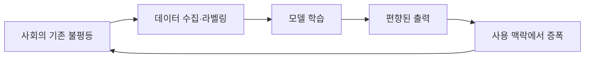

# 편향과 AI 윤리

> AI가 학습 데이터·설계·사용 맥락 때문에 특정 집단에 불공정한 결과를 내는 문제와 이를 다루는 원칙(공정성·투명성·책임).

## 쉽게 말하면
편식하며 자란 아이는 다른 음식을 "이상한 맛"이라 여긴다. 모델도 본 데이터가 한쪽으로 치우치면 그 세계관을 정답으로 안다. 그리고 문제는 알고리즘만이 아니라 그걸 쓰는 사회 맥락에서도 생긴다.

## 자세히
NIST SP 1270(2022년 3월)은 편향을 세 가지로 나눈다.
- **통계적·계산적 편향**: 데이터 대표성 부족, 알고리즘 설계에서 오는 편향.
- **인간 편향**: 데이터를 모으고 라벨 붙이고 해석하는 사람의 편향.
- **시스템 편향**: 제도·관행에 이미 있던 불평등이 데이터로 들어옴.
- 핵심 메시지: 편향을 **사회기술적(socio-technical)** 문제로 본다. 편향 위험을 0으로 만들 수는 없고 식별·관리하는 것이 목표이며, 이 문서가 법적 기준은 아니다(2차 요약 기준).
- 대응 예: 데이터 구성 점검, 집단별 성능 분리 측정([평가셋](#eval-set)에 집단별 문항), 사람의 검토, 설명 가능성, 사고 신고 절차. 규제는 [EU AI Act](#eu-ai-act), 관리 틀은 [NIST AI RMF](#nist-ai-rmf).

## 그림으로 보기

## 예시
- 채용 요약 도구가 과거 합격자 데이터를 배워 특정 성별 이력서를 낮게 평가.
- 업무 점검: 같은 질문을 이름·성별만 바꿔 던져 답이 달라지는지 비교.

## 헷갈리는 것과 비교
| 개념 | 차이 |
| --- | --- |
| 편향 | 결과가 치우침(현상) |
| 공정성 | 치우침을 줄이려는 목표와 지표 |
| [정렬](#ai-alignment) | 모델이 사람 의도·가치를 따르게 하는 더 넓은 문제 |

## 더 읽을거리
- [NIST SP 1270 (PDF)](https://nvlpubs.nist.gov/nistpubs/SpecialPublications/NIST.Sp.1270.pdf) — 편향 식별·관리 표준 제안
- [AI Governance Library 요약](https://www.aigl.blog/towards-a-standard-for-identifying-and-managing-bias-in-artificial-intelligence/) — SP 1270 해설
