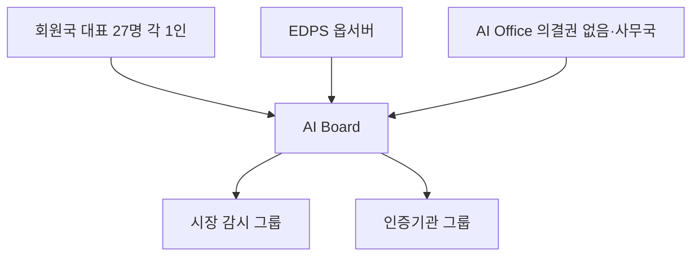

# AI Board (유럽 인공지능 위원회)

> EU AI Act 65조에 따라 회원국 대표로 구성되는 협의체. 집행위와 회원국이 AI Act를 일관되게 적용하도록 자문·조율하며, 사무국은 집행위의 AI Office가 맡는다.

## 쉽게 말하면
27개 회원국 담당자들이 같은 규칙을 제각각 해석하지 않도록 정기적으로 모여 기준을 맞추는 회의체다. 심판이 아니라 조율자다.

## 자세히
출처는 artificialintelligenceact.eu의 65조·66조(열람). 법률 자문이 아니다.
- **구성(65조)**: 회원국당 대표 1명. 유럽 개인정보감독관(EDPS)은 옵서버, 집행위 AI Office는 의결권 없이 참석하며, 그 밖의 국내·EU 당국이나 전문가를 사안별로 초청할 수 있다. 대표는 회원국이 3년 임기로 지정하고 1회 연임할 수 있다.
- **대표의 역할**: 관련 역량과 권한을 갖고, Board의 단일 연락 창구이며, 국내 관할 당국들을 조율할 수 있어야 한다.
- **운영**: 절차 규정은 대표들이 3분의 2 다수결로 채택하고 의장 선출·의결 방식·하부 그룹 운영을 다룬다. 의장은 회원국 대표 중 한 명이고, 사무국은 AI Office가 맡아 회의 소집(의장 요청)과 의제 준비를 한다. 객관성·공정성을 지키도록 조직·운영한다.
- **상설 하부 그룹**: 시장 감시, 인증기관·통지 당국 두 그룹. 시장 감시 그룹은 규정 2019/1020 30조의 행정 협력 그룹(ADCO) 역할을 한다. 자문 포럼 대표가 옵서버로 참여할 수 있다.
- **업무(66조)**: 집행위와 회원국을 자문·지원한다. 예: 국가 당국 조율과 시장 감시 공동 활동 지원, 전문성·모범 사례 공유, 범용 AI 모델 집행 자문, 샌드박스·실제 환경 시험 등 행정 관행 조화, 권고·서면 의견, AI 리터러시 증진 지원, 개념·벤치마크의 공통 기준 마련, 지침 문서 기여, 국제 협력 자문, 범용 AI 모델의 자격 경보에 대한 의견 제공(o항은 경보 관련 회원국 의견 수신).
- **샌드박스 관련**: 57조에 따라 종료 보고서에 접근할 수 있고 새 샌드박스 통지를 받는다([AI 규제 샌드박스](#ai-act-sandbox)).
- Board는 AI Office와 별개 기관이다. AI Office는 집행위 내 조직이다(다른 노드 참고).

## 그림으로 보기

## 예시
- 범용 AI 모델 집행 방식에 관한 질문이 회원국마다 다를 때 Board가 공통 이해를 위한 권고를 낸다(66조 c, e의 취지).
- 교육 실습: Board, AI Office, 국가 당국의 역할을 한 표에 정리.

## 헷갈리는 것과 비교
| 개념 | 차이 |
|---|---|
| AI Board | 회원국 대표 협의체, 자문·조율 |
| AI Office | 집행위 내 조직, 사무국·범용 AI 집행 |
| 국가 당국 | 각국에서 집행 |
| [AI 규제 샌드박스](#ai-act-sandbox) | Board가 종료 보고서 접근 |

## 더 읽을거리
- [AI Act Article 65](https://artificialintelligenceact.eu/article/65/) — 구성·운영(열람)
- [AI Act Article 66](https://artificialintelligenceact.eu/article/66/) — 업무(열람)
