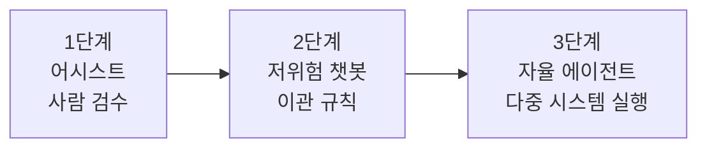

# 챗봇 vs 어시스트 도입 순서

> 고객 응대에 AI를 넣을 때 "고객이 직접 AI와 대화하는 챗봇"과 "상담사를 돕는 어시스트" 중 무엇을 먼저 넣을지, 위험도를 기준으로 정하는 판단.

## 쉽게 말하면
신입에게 처음부터 단독 매장을 맡기지 않고 선배 옆에서 일하게 하다가, 쉬운 업무부터 혼자 맡기는 것과 같다.

## 자세히
- **위험이 낮은 순서(여러 업계 글의 공통 권고, 대부분 벤더 자료)**: ① 어시스트(사람이 최종 검수) → ② 반복·저위험 문의에 한정한 챗봇 → ③ 여러 시스템에 걸쳐 직접 실행하는 자율 에이전트.
- **챗봇이 먼저인 경우**: 문의가 대량이고 반복적이며 답이 명확할 때. 한 벤더 글은 배포 기간을 챗봇 1~4주, 자율 에이전트 6~12주로 제시(주장).
- **사람에게 남길 것**: 환불·예외 같은 정책 판단, 법률·의료·컴플라이언스 문의.
- **핵심 가드레일**: 검증된 데이터·권한 범위 안에서만 동작, 모든 고객을 AI 거치게 강제하지 않기, [사람 이관](#human-handoff) 경로 마련.
- 기준표: 오류 비용(고객에게 바로 가는가), 문의 반복도, 답의 명확성, 검수 가능성.

## 그림으로 보기

## 예시
- 보험사: 상담사 어시스트로 시작 → 증명서 발급 안내 같은 저위험 문의만 챗봇 → 지표가 쌓이면 청구 접수 자동화.
- 소매 이커머스: 배송 조회가 대량이면 챗봇 먼저.

## 헷갈리는 것과 비교
| 개념 | 차이 |
|---|---|
| [에이전트 어시스트](#agent-assist) | 사람이 고객과 말함 |
| 챗봇 | AI가 직접 응대 |
| 자율 에이전트 | 시스템에 직접 실행까지 |

## 더 읽을거리
- [HappyFox: AI agent vs chatbot](https://blog.happyfox.com/ai-agent-vs-chatbot/) — 단계별 선택 기준(벤더)
- [Okoone: 챗봇과 어시스턴트의 역할](https://www.okoone.com/spark/technology-innovation/when-to-use-chatbots-and-when-to-use-ai-assistants/) — 역할 구분
