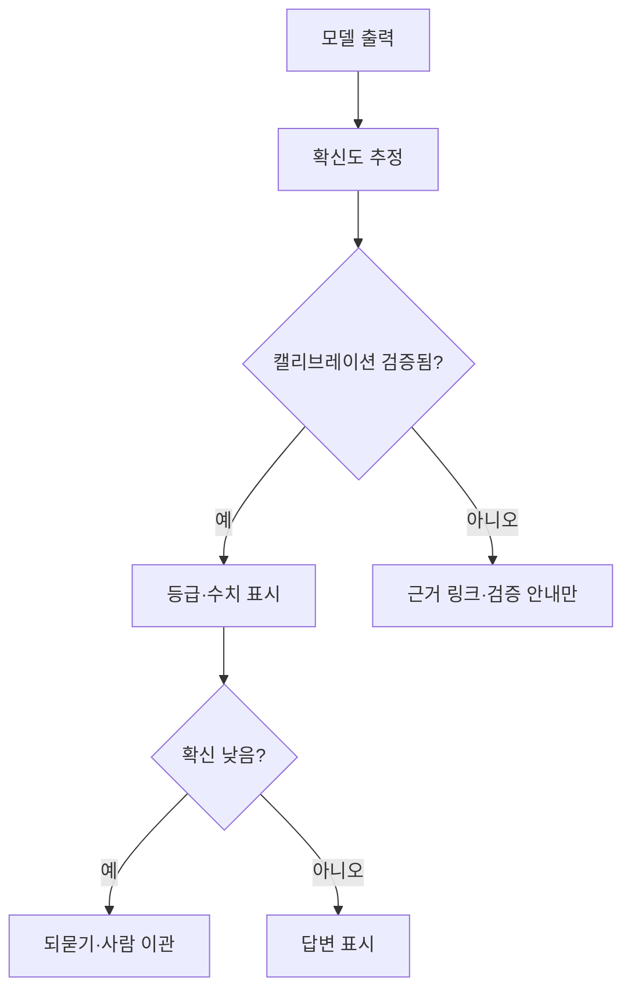

# AI 확신도 표시

> AI 답이 얼마나 믿을 만한지를 사용자에게 보여 주는 설계(퍼센트·등급·"확실하지 않음" 문구·근거 링크). 핵심은 보여 주는 값이 실제 정확도와 맞아야 한다는 것이다.

## 쉽게 말하면
일기예보의 "강수확률 70%"와 같다. 70%라고 했는데 비가 절반도 안 오면 사람들은 예보를 믿지 않는다. AI도 "99% 확실"이라 해 놓고 자주 틀리면 사용자가 과신하거나 신뢰를 잃는다.

## 자세히
- **문제**: LLM은 틀린 내용도 단정적 어조로 말한다. MetaFaith 연구(arXiv 2505.24858)는 거짓 주장에도 확신하는 어휘를 쓰는 경향이 과의존을 부른다고 보고한다. 사용자는 기본 설명이 붙으면 LLM 정확도를 과대평가한다(arXiv 2401.13835). 설명을 모델의 내부 확신에 맞추면 격차가 줄었다.
- **말로 표현한 확신(verbalized confidence)은 논쟁 중**: 질문 문구에 따라 결과가 갈리며, 좋은 프롬프트에서 큰 모델의 ECE가 0.07까지 내려간 보고도 있고, 정확도 낮은 사례에 높은 확신을 말하는 오보정 보고도 있다(arXiv 2412.14737 등). 초록·요약만 확인함.
- **표시 방식**: ① 숫자(캘리브레이션 필수) ② 3단계 등급(높음·중간·낮음) ③ 헤징 문구 ④ 근거 인용 링크 ⑤ 낮을 땐 답 대신 되묻기·이관([HAX 지침](#hax-guidelines) 10).
- **원칙**: 보여 주기 전에 [캘리브레이션](#calibration)을 측정한다(확신 80% 답의 실제 정답률이 약 80%인지). 안 맞으면 숫자 대신 등급이나 근거 제시가 안전하다.
- 과도한 경고는 무시당한다. 위험이 큰 구간에서만 강하게 표시한다.

## 그림으로 보기

## 예시
- 의료 요약: "근거 문서 3건 중 2건 일치 — 확인 필요" 처럼 근거 일치도를 표시.
- 검색형 챗봇: 확신 낮으면 "정확한 답을 찾지 못했어요. 담당자에게 연결할까요?"

## 헷갈리는 것과 비교
| 개념 | 차이 |
|---|---|
| 확신도 표시 | 사용자에게 보이는 UI |
| [캘리브레이션](#calibration) | 확신이 실제 정확도와 맞는 정도(측정) |
| [환각](#hallucination) | 틀린 내용을 그럴듯하게 만드는 현상 |

## 더 읽을거리
- [On Verbalized Confidence Scores for LLMs](https://arxiv.org/pdf/2412.14737) — 말로 표현한 확신의 신뢰성 논의
- [What LLMs Know and What People Think They Know](https://arxiv.org/pdf/2401.13835) — 사용자 과신 연구
- [MetaFaith](https://arxiv.org/html/2505.24858v2) — 불확실성 표현의 충실성
