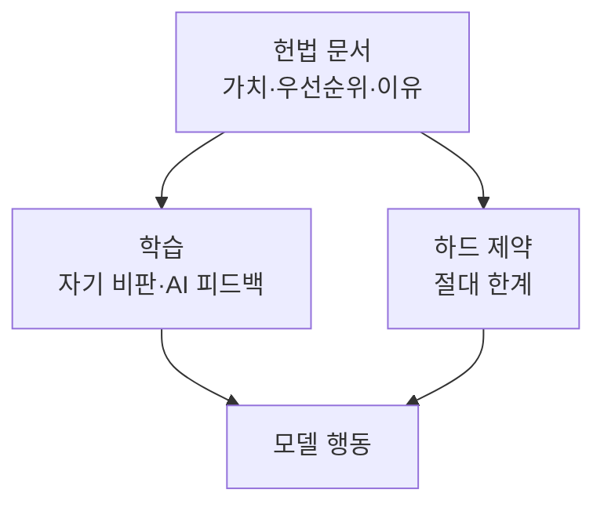
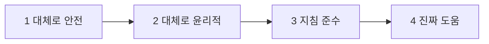

# 모델 헌법

> AI가 따를 가치·원칙·우선순위를 **자연어 문서로 명시**하고, 그것을 학습에 쓰는 방식. Anthropic은 2023년 5월 Constitutional AI용 원칙집을 공개했고, **2026년 1월 21일** 훨씬 길고 서술적인 새 "Claude의 헌법"을 공개했다.

## 쉽게 말하면
신입 직원에게 규칙 수백 줄을 외우게 하는 대신 "우리 회사가 무엇을 왜 중요하게 여기는지"를 길게 설명해 주고 상황에 맞게 판단하게 하는 것과 비슷하다. 대신 절대 넘으면 안 되는 몇 가지 선은 따로 못 박아 둔다.

## 자세히
- **2023 버전**(Anthropic 게시글, 2023-05-09): 원칙 목록으로 모델이 자기 응답을 비판·수정하게 하고, AI 피드백 강화학습([RLAIF](#rlaif))으로 덜 해로운 답을 고르게 훈련했다. 짧고 폭넓은 원칙이 긴 세부 원칙보다 일반화가 좋았다고 설명한다.
- **2026 버전**(공식 문서 `anthropic.com/constitution`, 공개일은 2026-01-21 보도 기준): 규칙보다 **가치와 판단력을 기르는 접근**을 택하되, 설명이 붙은 최소한의 규칙은 남긴다. 규칙은 예측 가능성·평가 용이성·조작 저항에서 장점이, 판단은 예상 못 한 상황 적응에서 장점이 있다고 논한다. 좁은 규칙을 훈련하면 모델의 자기 인식 전반에 영향을 줄 수 있다는 점도 근거로 든다.
- **핵심 속성 네 가지(충돌할 때의 우선순위)**:

| 순위 | 속성 | 의미 |
|---|---|---|
| 1 | 대체로 안전(broadly safe) | 현 단계에서 적절한 인간의 AI 감독을 훼손하지 않음(맹목적 복종 아님) |
| 2 | 대체로 윤리적(broadly ethical) | 좋은 가치·정직·해로운 행동 회피 |
| 3 | 지침 준수 | Anthropic의 구체적 지침을 따름 |
| 4 | 진짜 도움이 됨 | 운영자·사용자에게 실질적 이익 |

  우선순위는 **전체를 함께 저울질하는 방식(holistic)** 이지 엄격한 사전식 순서가 아니며, 대부분의 과업에서는 충돌이 없다고 밝힌다.
- **하드 제약**: 어떤 지시·그럴듯한 이유가 있어도 넘지 않는 절대 한계(예: 대량살상 무기 공격에 의미 있는 도움 제공 금지, 미성년자 성적 콘텐츠 금지). 정직은 공식 하드 제약은 아니지만 사실상 그에 준하게 다룬다고 한다.
- **학습에서의 위치**: 문서가 Claude의 행동을 직접 형성하는 "최종 권위"로 쓰이며, 훈련이 불완전해 행동이 이상과 어긋날 수 있음을 인정하고 투명하게 공개하겠다고 한다. 보도에 따르면 CC0(퍼블릭 도메인) 라이선스로 공개됐다(분량은 매체마다 57~80쪽으로 다르게 보도).
- 주의: 헌법 문서는 **회사의 설계 의도**이고 실제 모델 행동은 평가로 따로 확인해야 한다. 다른 회사에도 유사한 개념(예: OpenAI의 Model Spec)이 있다(이번에 열어 보지 않음).

## 그림으로 보기

## 예시
- 기업 교육: "AI가 왜 어떤 요청은 거절하는가"를 설명할 때 헌법의 우선순위(안전→윤리→지침→도움)와 "대부분은 충돌이 없다"는 점을 함께 보여 준다.
- 사내 AI 가이드라인을 만들 때 "규칙 목록"과 "이유 설명 + 소수의 금지선" 구성을 비교한다.

## 헷갈리는 것과 비교
| 개념 | 차이 |
|---|---|
| 모델 헌법 | 가치·원칙을 문서로 명시해 학습에 사용 |
| 시스템 프롬프트 | 배포 시점에 주는 지시(운영자 설정) |
| 이용 정책 | 사용자·고객이 지켜야 할 사용 규칙 |
| 모델 카드 | 모델 성능·위험 평가 보고서 |
| [Constitutional AI](#constitutional-ai) | 헌법을 학습에 쓰는 훈련 기법 |

## 더 읽을거리
- [Claude's Constitution (Anthropic)](https://www.anthropic.com/constitution) — 2026 버전 전문.
- [Claude's Constitution — 2023 post (Anthropic)](https://www.anthropic.com/news/claudes-constitution) — Constitutional AI 원칙집과 2026 개정 안내.
