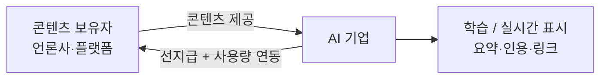
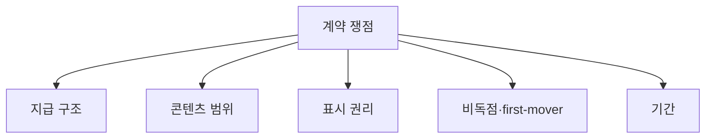

# AI 콘텐츠 라이선스 계약

> AI 기업이 언론사·플랫폼·출판사 등의 콘텐츠를 **학습이나 실시간 답변 표시에 쓰는 대가로 돈(또는 크레딧)을 내는 계약**이다. 데이터가 돈이 되는 시장이 실제로 형성되는 모습을 보여 준다. 공개된 금액 대부분은 **언론 보도·뉴스레터 추정치**여서 확정치가 아니다.

## 쉽게 말하면
음악을 가게에서 틀려면 저작권 사용료를 내듯, AI가 기사나 게시글을 학습·인용하려면 원작자와 사용 조건을 계약한다. 한 번에 목돈을 주는 계약, 쓴 만큼 내는 계약, 둘을 섞은 계약이 있다.

## 자세히
(출처: 미디어 뉴스레터 「The 7 Deal Points of AI Content Licensing Agreements」(Substack, 직접 열어 확인) + 검색 결과 요약. 금액은 모두 **보도·추정**이며 1차 계약서는 확인하지 못했다. Axios 원문은 403으로 열리지 않았다.)
- **계약의 7가지 쟁점(뉴스레터 정리)**
  1. **지급 구조**: 고정(선지급·최소 보장) + 변동(사용량 연동). 예: Dotdash Meredith은 OpenAI로부터 연 최소 1,600만 달러(보도), Taylor & Francis는 Microsoft로부터 1,000만 달러 이상 선지급+2027년까지 정기 지급(보도), News Corp은 5년간 2.5억 달러 이상(현금+크레딧, WSJ 보도).
  2. **콘텐츠 범위**: 학습·표시·기타 권리 포함 여부와 제외 항목. News Corp 계약은 Factiva와 HarperCollins를 제외했다는 보도. 일부(Washington Post, Guardian) 계약은 학습 권리를 언급하지 않는다.
  3. **표시 권리**: 요약·인용·로고·원문 링크. Washington Post는 ChatGPT가 "요약·인용·링크"를 보이게 허용.
  4. **AI 도구·기술 접근**: 언론사가 모델 조기 접근·공동 실험·맞춤 도구를 요구.
  5. **기술·운영 요건**: API·대량 덤프·실시간 피드·사용 보고서. Stack Overflow는 LLM에게 프롬프트 데이터 접근 요금을 받는다고 소개.
  6. **계약 조항**: **비독점이 보통**(Shutterstock, Reddit, Axel Springer, AP 등). AP는 타사가 더 좋은 조건을 받으면 재협상할 수 있다는 first-mover 조항이 보도됐다.
  7. **계약 기간**: AP/OpenAI 2년, Reddit/Google 2.5년, Axel Springer·Axios/OpenAI 3년, News Corp/OpenAI 5년, Shutterstock/OpenAI 6년, Wiley는 도서 아카이브 일회성 2,300만 달러(모두 보도).
- **다른 사례(검색 결과 요약)**: Reddit–Google은 연 약 6,000만 달러 보도, Reddit IPO 서류에는 데이터 라이선스 계약 총액 2.03억 달러·기간 2~3년이 공개됐다. Axel Springer–OpenAI는 금액 비공개이고 ChatGPT 요약에 링크·출처 표기. 최근에는 **AI가 실시간으로 가져오거나 근거로 쓸 때 지급**하는 사용량 연동 구조로 가는 흐름이 보도된다(해석 가능성 있음).
- **한계·주의**: 금액은 상호 비교하기 어렵다(범위·기간 다름). 확인되지 않은 추정과 확정 보도가 섞여 있다.

## 그림으로 보기

## 예시
- News Corp–OpenAI: 5년, 2.5억 달러 이상(WSJ 보도), 현금과 크레딧 포함.
- Reddit–Google: 연 약 6,000만 달러(보도), Gemini 학습용.
- 교육 활동: 우리 회사 콘텐츠를 AI에 제공한다면 7가지 쟁점 중 무엇을 가장 중요하게 볼지 정리해 본다.

## 헷갈리는 것과 비교
| 개념 | 차이 |
|---|---|
| 라이선스 계약 | 권리자와 합의해 대가 지급 |
| 저작권 소송 | 무단 사용을 법정에서 다툼 |
| [중복 데이터와 가치 평가](#duplicate-data-valuation) | 데이터 가치를 어떻게 매길지의 기술적 문제 |
| [데이터 보상 시장](#data-compensation-markets) | 상위 개념 |

## 더 읽을거리
- [The 7 Deal Points of AI Content Licensing Agreements (Media and the Machine)](https://mediaandthemachine.substack.com/p/the-7-deal-points-of-ai-content-licensing) — 계약 쟁점 7가지와 보도된 사례(직접 확인).
