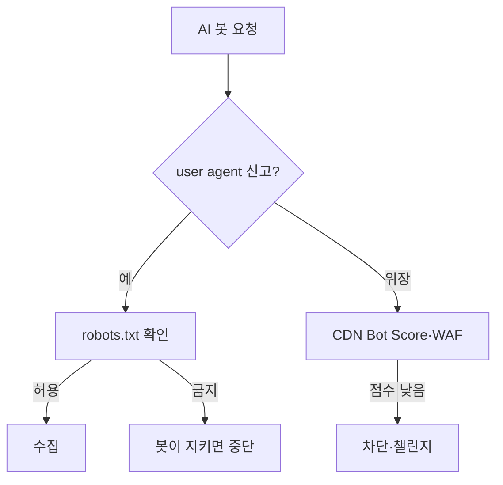
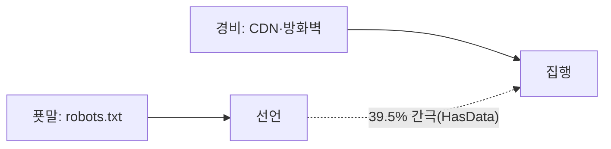

# AI 크롤러 차단

> 웹사이트가 AI 학습·검색용 봇(GPTBot, ClaudeBot, CCBot 등)의 수집을 막는 방법과 그 보급 현황이다. robots.txt로 "요청"하는 방식과 CDN·방화벽으로 "실제 차단"하는 방식이 있다.

## 쉽게 말하면
가게 앞 "출입 금지" 푯말(robots.txt)을 세우는 것과, 경비원이 신분증을 확인해 못 들어오게 하는 것(서버·CDN 차단)의 차이다. 푯말은 지키는 사람만 지키고, 경비원은 위장한 사람도 걸러낼 수 있다.

## 자세히
- **방법 1, robots.txt**: `User-agent: GPTBot` / `Disallow: /` 같은 규칙. 봇이 정직하게 신분을 밝히고 규칙을 지킬 때만 작동한다([robots.txt와 이용약관 불일치](#robots-txt-vs-tos)).
- **방법 2, 네트워크 차단**: Cloudflare는 2024-07-03 "AI Scrapers and Crawlers" 토글(Security > Bots, 무료 요금제 포함)을 내놨다. 머신러닝 Bot Score는 user agent를 무시하고 전역 신호로 판단하며, 같은 글에서 위장한 Perplexity 트래픽의 점수가 9 이하(기준 30 미만이면 차단 권장)였다고 사례를 든다(Cloudflare 블로그, 직접 확인. 벤더 주장).
- **2024년 6월 당시 수치(Cloudflare)**: 상위 100만 보호 사이트의 약 39%에 AI 봇이 접근했으나 차단·챌린지는 2.98%. Bytespider 40.4%, GPTBot 35.5%, ClaudeBot 11.2% 사이트에 접근.
- **2026년 수치(HasData, 스크래핑 API 판매사라 이해관계 있음)**: 상위 웹 10.3%, 뉴스 퍼블리셔 56.4%가 robots.txt로 AI 크롤러를 하나 이상 차단(7월). GPTBot 한정 7.9%/50.5%. GPTBot을 금지한 592개 중 234개(39.5%)는 여전히 GPTBot에 실제 페이지를 줬다 → **선언과 집행의 간극**. 반대로 선언 없이 막는 "silent enforcer"가 7월 115곳→9월 178곳. 9월 15일 Cloudflare의 관리형 AI 차단 변경 뒤 robots.txt 선언은 줄었지만 일부는 계속 차단되었다고 보고했다.
- **한계**: 규칙 중복·오탐으로 검색엔진·광고 봇까지 막을 위험, 학습용·검색용·사용자 요청용 봇을 구분해야 하는 문제. 이미 수집된 데이터에는 소급되지 않는다([소급 불가 옵트아웃](#retroactive-opt-out-gap)).

## 그림으로 보기

## 예시
- 매체가 robots.txt에 GPTBot·CCBot를 금지하고 Cloudflare 토글도 켠다: 정직한 봇은 멈추고 위장 봇은 점수로 차단.
- 데이터 수집자 입장: 차단 신호를 우회하지 않고 존중 기록을 남긴다.
- 교육 소재: 내 회사 사이트의 robots.txt를 열어 AI 봇 규칙을 점검하는 실습.

## 헷갈리는 것과 비교
| 개념 | 차이 |
|---|---|
| robots.txt 금지 | 요청, 봇이 따라야 효력 |
| CDN 차단 | 서버 도달 전 집행 |
| [데이터셋 라이선스 체크리스트](#dataset-license-checklist) | 수집 후 사용 조건 점검 |
| [AI 데이터 커먼즈](#ai-data-commons) | 허용된 데이터를 모으는 대안 |

## 더 읽을거리
- [Cloudflare: Declaring your AIndependence (2024-07-03)](https://blog.cloudflare.com/declaring-your-aindependence-block-ai-bots-scrapers-and-crawlers-with-a-single-click/) — 원클릭 차단·수치(직접 확인).
- [PPC Land: HasData AI Crawler Block Index](https://ppc.land/cloudflare-drops-ai-opt-outs-from-118-sites-robots-txt-hasdata-finds/) — 2026 선언 vs 집행 조사(직접 확인, 2차 보도).
