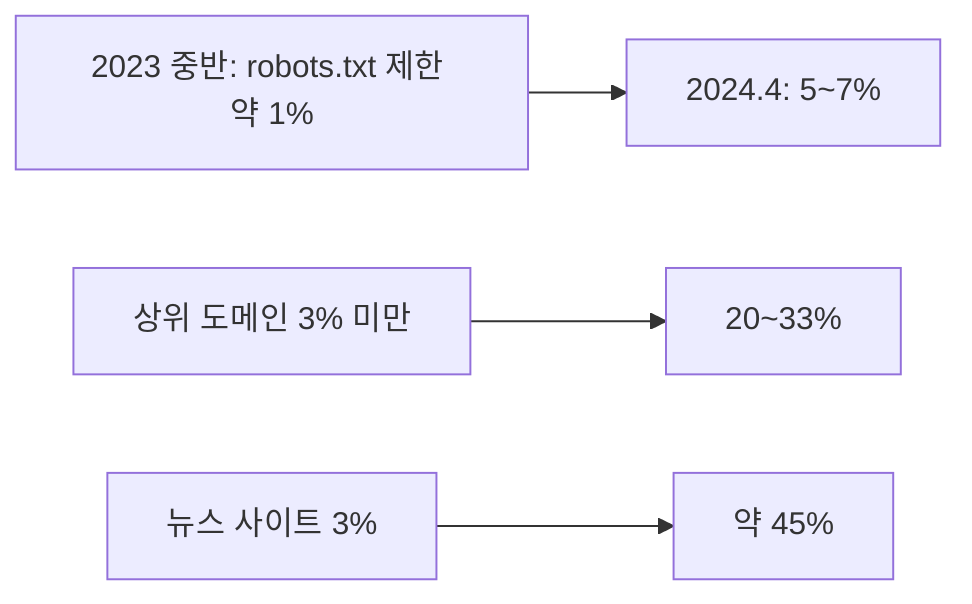
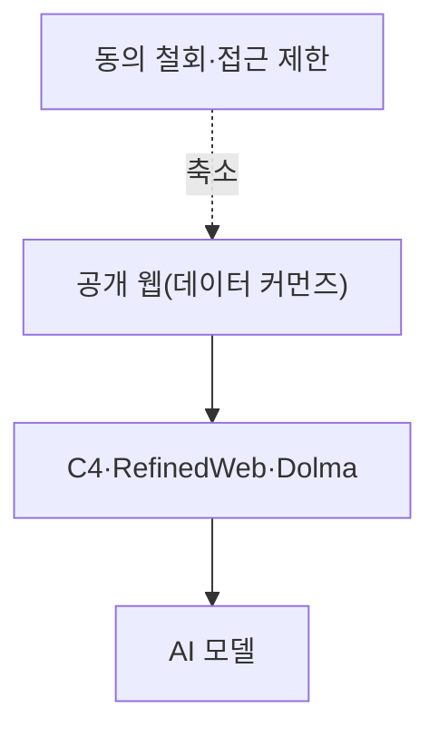

# AI 데이터 커먼즈

> 범용·멀티모달 AI 학습의 주된 공동 데이터 원천인 공개 웹을 가리키는 표현이다. Longpre 외(2024)는 이 공동자원이 크롤링 동의 철회로 빠르게 줄고 있다고 보고한다.

## 쉽게 말하면
마을 공동 목초지에 모두가 소를 풀어 놓다가, 주인들이 울타리를 치기 시작하는 상황이다. AI 학습에 쓰이던 웹 데이터에 접근 제한이 늘어난다.

## 자세히
(Longpre 외 arXiv 2407.14933을 하위 에이전트가 PDF로 읽은 노트. 14k 도메인의 세부 구성 일부는 에이전트의 계산이라 미확정.)
- **대상 코퍼스**: C4(15,928,138 도메인, 2019.4 크롤), RefinedWeb(33,210,738, 2008~2023.2), Dolma(45,246,789, 2020.5~2023.6). 초록 기준 **14,000개 웹 도메인** 감사.
- **robots.txt 제한 증가(2023.4→2024.4)**: 전체 코퍼스 토큰 약 1%(2023 중반) → **5~7%**(2024.4). 핵심 상위 도메인(HeadAll)은 3% 미만 → **20~33%**(초록: C4의 핵심 출처 28%+). 상대 증가는 전체 500%+, 상위 1000%+.
- **뉴스 사이트**: 토큰의 약 **45%**가 robots.txt로 제한(2023은 3%).
- **약관**: C4의 45%, 세 코퍼스 45~55%([약관 vs robots.txt](#tos-vs-robots-txt)).
- **예측**: SARIMA로 2025.4까지 전체 코퍼스 토큰 추가 2~4%p(상위 도메인 7~11%), 약관 제한 +6~10%.
- **부수 발견**: 상위 도메인은 뉴스·백과·소셜 편중, 광고(+47.5%)·유료 장벽(+24.1%) 비율이 높다. 실제 대화형 AI 사용 양상과도 불일치.
- **함의(제안)**: 공개 데이터가 줄면 최신성·다양성이 떨어지고 접근 가능한 데이터가 특정 주체에 쏠릴 수 있다.

## 그림으로 보기

## 예시
- 학습 코퍼스 구성 시 도메인별 접근 제한 현황을 점검해 데이터 확보 위험을 평가.
- 교육 활용: 데이터 윤리와 저작권·동의 논쟁의 배경 자료.

## 헷갈리는 것과 비교
| 개념 | 차이 |
|---|---|
| 데이터 커먼즈 | 공동으로 쓰이는 공개 데이터 풀 |
| 오픈 라이선스 데이터 | 이용 조건이 명시된 데이터 |
| [Gopher 휴리스틱](#gopher-quality-heuristics) | 품질 필터(동의와 별개) |

## 더 읽을거리
- [Consent in Crisis (arXiv 2407.14933)](https://arxiv.org/abs/2407.14933) — 표·예측.
