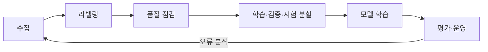
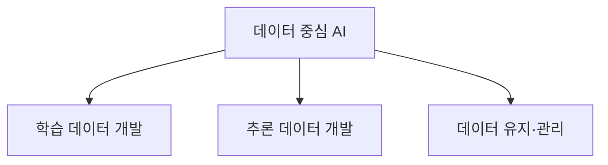

# AI 데이터(수집·라벨링·품질)

> 모델이 배우는 재료인 데이터를 모으고, 정답을 붙이고, 품질을 점검하고, 계속 관리하는 분야다. 같은 모델이라도 어떤 데이터로 배웠는지에 따라 성능과 편향이 달라지므로, AI를 이해하는 큰 줄기 중 하나다.

## 쉽게 말하면
요리에서 레시피(모델)가 같아도 재료(데이터)가 상하거나 섞여 있으면 맛이 나쁘다. AI 성능을 올릴 때 레시피만 만지작거리지 말고 재료부터 점검하자는 관점이 "데이터 중심 AI"다.

## 자세히
- **데이터 중심 AI(data-centric AI)**: 모델 설계를 개선하는 데서 데이터의 질과 양을 개선하는 쪽으로 관심을 옮기는 관점. Zha 등의 서베이(arXiv:2303.10158, 2023-03 제출, v3 2023-06)가 정리하며, 연구자·실무자의 초점이 모델에서 데이터로 이동했다고 설명한다(초록 확인).
- **서베이의 세 목표(초록 확인)**: ① 학습 데이터 개발 ② 추론 데이터 개발(모델이 예측할 때 입력으로 쓰는 데이터) ③ 데이터 유지·관리. 이 지도의 하위 노드도 이 틀을 따라 확장한다(제안).
- **유명한 사례(검증 안 됨)**: 철강 결함 검출기 정확도가 76.2%에서 일관되지 않은 라벨을 고쳤더니 93.1%가 됐다는 이야기가 Ultralytics 용어집 등에 인용되지만 Ng의 원자료로 확인하지 못했다.
- **"데이터 작업이 80%"**: 여러 사이트가 Ng에게 돌리는 말이지만 정확한 인용이 아니라 대중적 패러프레이즈로 본다.
- **데이터 분할**: 학습·검증·시험 세트를 나누고, 시험 세트가 학습에 새어 들어가지 않게 중복을 제거해야 한다(검색 결과의 데이터 중심 가이드). 시험용 평가 세트 자체도 별도로 신경 써서 만든다.
- **검증 도구(검색 결과 기준)**: Great Expectations, TensorFlow Data Validation(TFDV), Amazon Deequ 같은 오픈소스가 수집 시점 검증에 쓰인다.
- **LLM 시대에도**: 사전학습 데이터 선별, 지시 튜닝 데이터, 합성 데이터, 평가 세트 오염 점검이 모두 같은 줄기다. 가지는 아래로 뻗는다.

## 그림으로 보기

## 예시
- 고객 문의 분류기가 자꾸 틀린다 → 모델을 바꾸기 전에 틀린 사례 100건을 열어 라벨이 일관된지, 중복·누락이 있는지 먼저 본다.
- 사내 RAG 챗봇 품질 문제 → 문서 중복·낡은 버전·누락부터 정리하는 것도 데이터 품질 작업이다.

## 헷갈리는 것과 비교
| 개념 | 차이 |
|---|---|
| 모델 중심 AI | 모델 구조·튜닝으로 성능 개선 |
| 데이터 중심 AI | 데이터 품질·양·관리로 개선 |
| [합성 데이터](#synthetic-data) | 데이터를 인공적으로 만드는 방법 |
| [AI 평가](#ai-evaluation) | 모델을 재는 일(평가 세트도 데이터) |

## 더 읽을거리
- [Data-centric Artificial Intelligence: A Survey (arXiv:2303.10158)](https://arxiv.org/abs/2303.10158) — 데이터 중심 AI의 세 목표와 문헌 정리(초록 직접 확인).
- [JFrog: What is Data-Centric AI?](https://jfrog.com/learn/mlops/data-centric-ai/) — 개념·MLOps 연결(검색 결과 기준, 본문 미열람).
