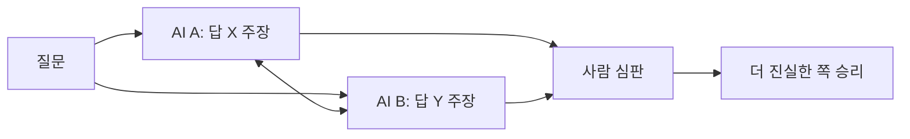
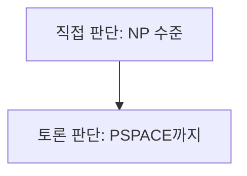

# AI 토론

> **AI 토론(debate)** 은 두 AI가 한 질문에 대해 **반대 입장**으로 논증하고, 능력이 낮은 **사람 심판**이 더 진실한 쪽을 고르게 해 심판이 직접 판단하기 어려운 문제까지 감독하려는 방법이다.

## 쉽게 말하면
의학 논문이 어려워도 두 전문가가 서로의 허점을 지적하게 하면 일반인도 누가 더 근거가 탄탄한지는 가려낼 수 있다. 어려운 판단을 "누구 말이 맞나"라는 쉬운 판단으로 바꾸는 것이다.

## 자세히
(Irving 외, arXiv 1805.00899 초록 확인)
- **게임**: 두 에이전트가 제로섬 게임에서 반대 주장을 편다. 사람이 더 **진실하고 유용한 정보**를 낸 쪽을 정한다.
- **MNIST 실험**: 에이전트들이 희소 분류기를 설득하는 설정. 분류기가 보는 픽셀이 **6개**일 때 정확도 **59.4% → 88.9%**, **4개**일 때 **48.2% → 85.2%**.
- **복잡도 유추 주장**: 최적 플레이와 다항 시간 심판 가정에서 토론은 **PSPACE** 질문까지 답할 수 있고, 직접 판단은 **NP** 수준이라고 논증한다.
- **단서**: 실제 효과는 사람과 과제에 대한 실증 문제라고 저자들이 명시한다.
- 후속 실험·한계는 이 글에서 확인하지 않았다(일반 지식: 심판이 설득에 취약할 수 있어 연구가 계속됨).

## 그림으로 보기

## 예시
- 긴 계약서의 위험 조항 존재 여부를, 한 AI는 "위험하다", 다른 AI는 "아니다"로 논증하게 하고 사람은 핵심 근거만 확인.

## 헷갈리는 것과 비교
| 개념 | 차이 |
|---|---|
| AI 토론 | 두 AI가 적대적으로 논증 |
| [비판·수정 루프](#critique-revision) | 한 모델이 자기 답을 개선 |
| [독립 리뷰어](#independent-reviewer) | 별도 맥락 검토자 |
| [약한→강한 일반화](#weak-to-strong) | 약한 라벨로 강한 모델 학습 |

## 더 읽을거리
- [AI safety via debate](https://arxiv.org/abs/1805.00899)
