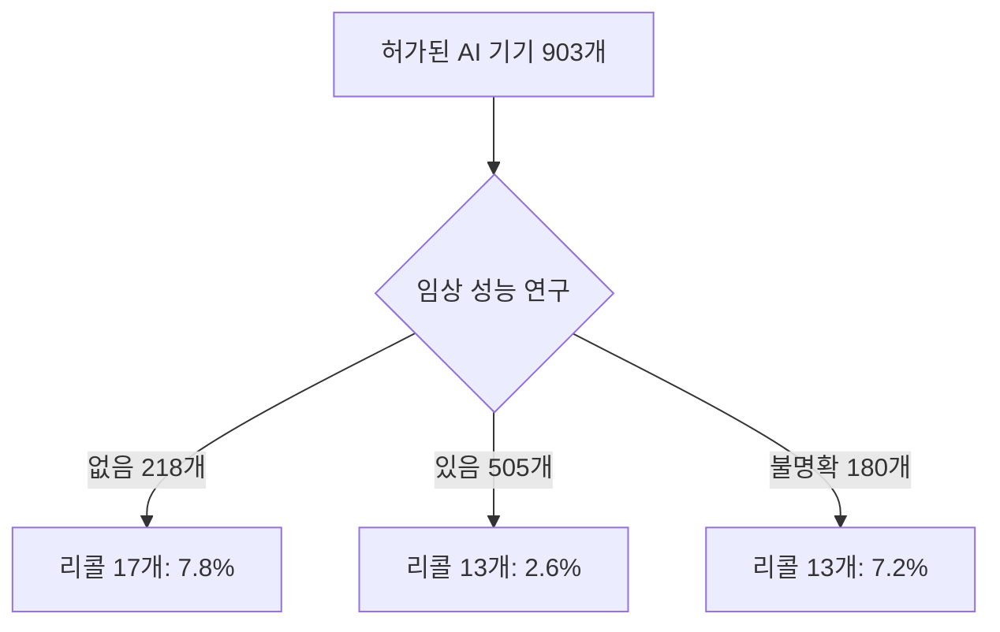

# AI 기기 리콜

> 허가된 AI 의료기기가 시판 후 회수·시정 조치를 받은 사례. 2025년 JAMA 계열 연구는 임상 성능 연구가 없는 기기에서 리콜률이 높았지만 통계적 근거는 약하다고 보고한다.

## 쉽게 말하면
시험 운전 기록이 없는 차에서 리콜이 많이 나오는지를 묻는 것과 같다. 경향은 보이지만 숫자가 적어 단정하기엔 이르다.

## 자세히
출처: JAMA Network 논문 페이지(2026-11-15 확인, 끝부분 5,800자는 읽지 못함). 제목은 검색 결과상 "Early Recalls and Clinical Validation Gaps in AI-Enabled Medical Devices".
- **표본**: FDA 허가 AI 기기 903개(1995~2024년 허가, 검색 요약).
- **리콜**: 43개(4.8%)가 리콜됐고 리콜까지 중앙값 458일(IQR 263~1,092, 약 15개월).
- **임상 검증과의 관계**: 임상 성능 연구가 없는 기기의 리콜률 7.8%(17/218), 있는 기기 2.6%(13/505). 정보가 불명확한 기기는 7.2%(13/180). 정보 불명 그룹의 위험비 1.39(95% 신뢰구간 0.84~3.52)로 구간이 1을 포함해 연관성의 근거는 약하다고 해석된다.
- **공개 기업이 많다는 보도**: 검색 결과는 리콜 대부분이 상장 기업에서 나왔다고 하지만, 논문 페이지에서는 이 수치를 확인하지 못했다.
- 혼동 주의: UNC 연구(Nature Medicine, 2024)는 임상 검증 공개 여부를, 이 연구는 리콜을 다룬다. 표본·정의가 다르다.
- 해석: 리콜이 곧 환자 피해는 아니며, 리콜 원인(소프트웨어 오류, 표시 문제 등)은 이 글에서 확인하지 못했다.

## 그림으로 보기

## 예시
- 병원 도입 점검: 후보 AI의 FDA 기록에서 임상 성능 연구 유무, 다기관·전향적 여부, 과거 리콜 여부를 체크.
- 제조사: 시판 후 오류 보고 체계로 조기 리콜 위험을 줄임([시판 후 감시](#post-market-surveillance)).

## 헷갈리는 것과 비교
| 개념 | 차이 |
|---|---|
| 리콜 | 회수·시정 조치 |
| 허가 취소 | 시판 허가 철회, 다른 개념 |
| [후향적 vs 전향적](#retrospective-vs-prospective) | 검증 설계 차이 |

## 더 읽을거리
- [JAMA Netw Open 논문 페이지](https://jamanetwork.com/journals/jamanetworkopen/fullarticle/2850190) — 리콜률과 임상 연구 유무(핵심 수치 확인)
