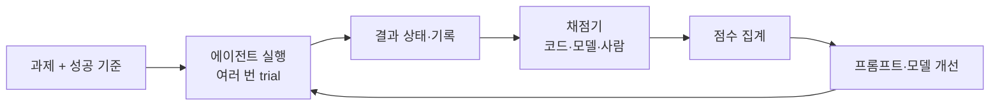
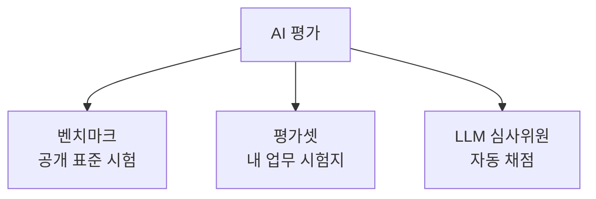

# AI 평가·벤치마크

> 모델·에이전트·프롬프트가 "얼마나 잘 하는지"를 숫자로 재는 일. 바꾸기 전과 후를 비교할 수 있어야 개선이라고 말할 수 있다.

## 쉽게 말하면
요리사를 뽑을 때 "맛있어 보인다"로 뽑지 않고, 같은 재료로 같은 요리를 시켜 보고 점수를 매기는 것과 같다. 시험지(과제), 채점 기준(채점기), 시험 감독(실행 장치)이 있어야 공정하다. 그리고 한 번 잘했다고 믿지 않고 여러 번 시켜 본다.

## 자세히
Anthropic 엔지니어링 글("Demystifying evals for AI agents") 기준 구성요소:
- **Task(과제)**: 입력과 성공 기준이 분명한 테스트 1개. 모델 출력이 매번 달라서 과제마다 여러 번(trial) 돌린다.
- **Grader(채점기)**: 점수를 매기는 로직. 코드 기반(문자열 매칭·단위 테스트, 빠르고 객관적), 모델 기반(루브릭·쌍 비교, 유연하지만 비결정적이라 사람 평가로 교정), 사람(골드 스탠다드지만 비쌈).
- **Outcome**: 답변 문장이 아니라 환경의 최종 상태. "예약했습니다"보다 DB에 예약이 있는지를 본다.
- **Evaluation harness**: 과제 실행·기록·채점·집계 인프라. 에이전트 평가는 모델과 [하네스](#harness)를 함께 평가한다.
- **pass@k**: k번 중 한 번이라도 성공할 확률(올라감). **pass^k**: k번 모두 성공할 확률(내려감). 시도당 75%면 3번 연속 성공은 약 42%라서, 고객 응대처럼 매번 안정적이어야 하면 pass^k를 본다.
- 시작은 실제 실패 사례에서 뽑은 20~50개로 충분하다. 점수가 100%에 포화되면 회귀 테스트로 돌리고 더 어려운 과제를 추가한다.

## 그림으로 보기

## 예시
- 고객 문의 봇을 바꾸기 전에 지난달 실패 30건을 평가셋으로 만들어 새 프롬프트 점수를 비교한다.
- 코딩 에이전트: 수정 후 단위 테스트가 통과하는지(코드 채점기)로 판정한다.

## 헷갈리는 것과 비교
| 개념 | 차이 |
| --- | --- |
| [벤치마크](#benchmarks) | 모두가 같이 푸는 공개 시험. 모델 간 비교용 |
| [평가셋](#eval-set) | 내 업무에 맞춘 사설 시험. 개선 확인용 |
| [LLM 심사위원](#llm-as-judge) | 채점 방법의 하나(모델 기반 채점기) |

## 더 읽을거리
- [Demystifying evals for AI agents (Anthropic)](https://www.anthropic.com/engineering/demystifying-evals-for-ai-agents) — 구성요소·채점기·pass@k 설명
