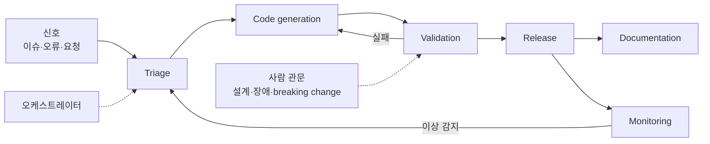

# AI 팩토리

> 이슈·오류 같은 신호를 받아 역할별 에이전트가 공장 라인처럼 분류 → 구현 → 검증 → 배포 → 감시까지 이어서 처리하고, 판단이 필요할 때만 사람을 부르는 운영 구조. (정확히는 "AI 소프트웨어 팩토리")

## 쉽게 말하면
수제 공방은 장인 한 명이 처음부터 끝까지 만든다. 공장은 접수·가공·검수·출하 라인으로 나누고 각 자리에 전담자를 두며, 불량은 검수대에서 걸러진다. AI 팩토리는 이 방식을 소프트웨어 제작에 옮긴 것이다. 단독 코딩 에이전트는 '숙련공 한 명'이고, 팩토리는 라인과 품질 관리 체계 전체다.

## 자세히
Mastra 블로그(2026-07-16) 정의와 구성:
- **입력**: GitHub·Sentry·Linear 등의 실제 신호를 구조화된 작업으로 바꾼다.
- **역할 6개**: Triage(분류·우선순위), Code generation(구현·테스트), Validation(품질 관문), Release(배포), Documentation(문서 어긋남 수정), Monitoring(운영 감시). 한 에이전트가 한 일만 하므로 한 기준으로 평가할 수 있다. **오케스트레이터**가 애매한 일을 알맞은 곳으로 보낸다.
- **인계는 구조화된 데이터로만** 한다(맥락 손실·환각 전파 방지).
- **사람의 관문**: 아키텍처 선택, breaking change, 검증 실패, 장애 대응. 글은 "모든 PR을 보는 것보다 에이전트 지침을 승인하는 것이 더 중요한 관문"이라고 주장한다.
- **루프 3개**: 개발 루프 / 운영 이상이 다시 작업이 되는 모니터링 루프 / 코드와 문서 차이를 찾는 드리프트 루프.
- 지식 기반 정리(2026-10-26): 병목은 생성이 아니라 **검증**이다(Faros 텔레메트리: PR +98%인데 리뷰 시간 +91% — 벤더 데이터). 사람이 전혀 개입하지 않는 "dark factory" 시도도 있으나 Mastra는 모든 변경에 권하지 않는다.
- **같은 이름, 다른 뜻**: NVIDIA의 "AI factory"는 토큰을 생산하는 데이터센터(하드웨어 개념)다. 소프트웨어 팩토리와 무관하다.

## 그림으로 보기

## 예시
- 새벽에 Sentry 오류 발생 → Triage가 P1로 분류 → 코드 에이전트가 수정 PR → 검증 에이전트가 테스트·보안 점검 → 사람은 아침에 승인만.
- 개인 규모: 이 지도를 키우는 점심 루틴도 "후보 선정 → 조사 → 작성 → 검사(check.py) → push"라는 소형 라인이다.

## 헷갈리는 것과 비교
| 개념 | 차이 |
| --- | --- |
| [하네스](#harness) | 에이전트 한 개를 일하게 만드는 틀. 팩토리는 하네스 여러 개를 라인으로 연결 |
| [오케스트레이터-워커](#orchestrator-workers) | 팩토리 안에서 쓰는 분배 패턴 |
| [에이전트 루프](#agent-loop) | 단일 에이전트의 반복. 팩토리는 단계 사이 인계와 관문까지 포함 |
| NVIDIA AI factory | 토큰을 만드는 데이터센터. 이름만 같음 |

## 더 읽을거리
- [Software Factory (Mastra, 2026-07-16)](https://mastra.ai/blog/software-factory) — 6역할·관문·루프 3개. 벤더 글이라 효과 수치는 주장으로 읽을 것
- 사용자 지식 기반 `ai-knowledge/wiki/concepts/ai-software-factory.md` — Augment 가이드 등을 합친 참조 아키텍처
