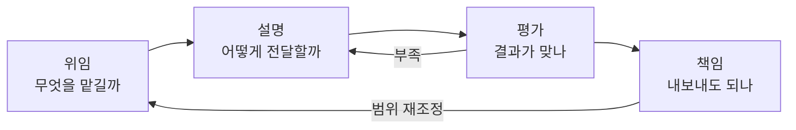

# AI Fluency 4D

> AI와 효과적·윤리적·안전하게 일하는 능력을 위임(Delegation)·설명(Description)·평가(Discernment)·책임(Diligence) 네 가지로 나눈 프레임워크.

## 쉽게 말하면
새 동료에게 일을 맡기는 일과 같다. 무엇을 맡길지 정하고(위임), 목표와 맥락을 잘 설명하고(설명), 돌아온 결과를 비판적으로 살피고(평가), 최종 결과에 내가 책임진다(책임). 이 중 하나만 빠져도 사고가 난다.

## 자세히
Anthropic AI Fluency 과정(Rick Dakan·Joseph Feller와 공동, CC BY-NC-SA 4.0) 요약:
- **Delegation**: 목표를 정하고 AI에 맡길지·언제·어떻게 쓸지 결정.
- **Description**: 원하는 결과를 내도록 목표·맥락·형식을 전달. 프롬프트를 넘어 소통 전략 전체.
- **Discernment**: 결과·추론·대화 방식이 쓸 만한지 정확히 판단. 단순 사실 확인 이상.
- **Diligence**: AI를 어떻게 쓰고 무엇을 내보내는지에 대한 책임, 윤리·안전.
- 네 가지는 체크리스트가 아니라 **순환**: 설명↔평가 고리(결과를 보고 설명을 고침), 위임↔책임 고리.

## 그림으로 보기

## 예시
- 회의록 요약: 위임(요약은 맡기고 결정은 내가), 설명(독자·길이·형식 지정), 평가(실제 발언과 대조), 책임(기밀 정보 제거 후 공유).
- 이 지도의 [평가셋](#eval-set)·[편향](#ai-bias-ethics)은 평가와 책임을 구체화한 도구다.

## 헷갈리는 것과 비교
| 개념 | 차이 |
| --- | --- |
| 프롬프트 엔지니어링 | 4D 중 설명의 일부 |
| AI 리터러시 | AI를 이해하는 지식 중심 |
| AI Fluency | 협업 행동 역량 중심 |

## 더 읽을거리
- [Inside Anthropic's AI Fluency Masterclass (The Neuron)](https://www.theneuron.ai/explainer-articles/inside-anthropics-ai-fluency-masterclass-on-human-ai-collaboration) — 해설
- [4D AI Fluency (Envisioning)](https://www.envisioning.com/vocab/4d-ai-fluency) — 용어 정리
