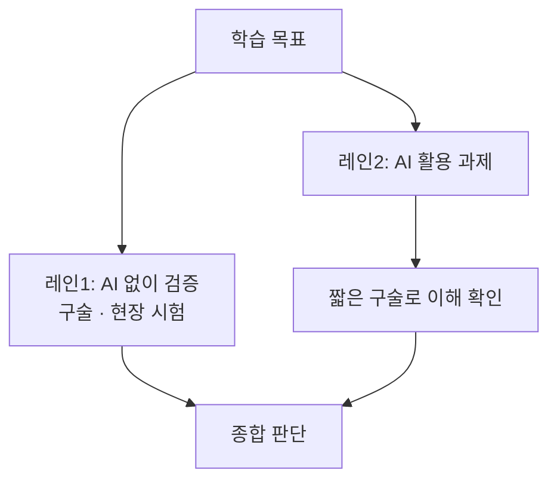

# AI 없는 평가 설계

> AI 없는 평가는 구술시험·현장 필기·즉석 시연처럼 AI 도움 없이 학습자가 직접 아는 것을 보이게 하는 평가 설계다.

## 쉽게 말하면
운전면허는 내비게이션을 끄고 직접 도로를 달려야 딴다. 숙제는 도구를 써도 되지만 "진짜 실력 확인"은 도구를 치운 자리에서 한다.

## 자세히
- 대학 가이드(LSE 2026-03 등)는 대면 평가(필기·구술·발표·수업 중 퀴즈)를 학업 진실성을 지키는 가장 효과적인 방법으로 보되, 인기가 낮고 편의 조정 수요가 늘 수 있다고 적는다.
- **두 갈래 모델**(Sydney의 Danny Liu 제안, 2차 요약): 1레인은 AI 없이 아는 것을 검증(감독 시험·구술), 2레인은 AI를 쓰는 과제로 활용 능력을 평가.
- **과제 후 구술 확인**: 과제는 AI 허용, 이후 짧은 구술·화이트보드 시연(Harvard Bok Center)으로 이해 확인. 큰 수업은 소그룹 상호작용 구술이 현실적.
- AI 탐지기 의존은 비권장(Vanderbilt 등 여러 대학이 Turnitin AI 탐지 사용 자제 안내, 2차 보도).
- 한계: 완전한 "AI-proof"는 없고 "AI-resistant"가 현실적이며, 한 가지가 아니라 평가 혼합이 낫다.

## 그림으로 보기

## 예시
사내 교육 최종 평가: 프로젝트는 AI 허용, 마지막 10분 면담에서 "이 부분을 왜 이렇게 했나요? 대안은?"을 묻는다.

## 헷갈리는 것과 비교
| 개념 | 차이 |
|---|---|
| AI 없는 평가 | 설계로 해결 |
| AI 탐지 | 사후 판별, 오탐 위험으로 비권장 |
| [AI 튜터 성과 측정](#tutor-outcome-measurement) | 연구용 AI 금지 사후 시험과 같은 원리 |
| [AI 목발 효과](#ai-as-crutch) | 이 평가가 드러내는 현상 |

## 더 읽을거리
- [LSE: How to Build AI Resilient Assessment (2026-03)](https://info.lse.ac.uk/staff/divisions/Eden-Centre/Assets-EC/Documents/AI-docs-2025-26/How-to-Build-AI-Resliience-Assessment-final-March-9-2026.pdf) — 대학 평가 설계 안내.
- [Stephen Turner: How do you design AI-resistant assignments?](https://blog.stephenturner.us/p/ai-resistant-assignments) — 과제+구술 사례.
- [UBC Arts: AI-resilient assessments](https://isit.arts.ubc.ca/?p=21892) — 교수자용 가이드.
