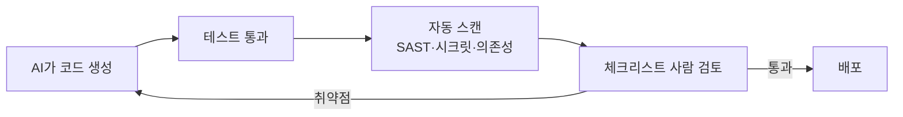

# AI 생성 코드 보안 리뷰

> AI가 쓴 코드는 돌아가더라도 안전하다는 보장이 없으므로, 배포 전에 취약점 체크리스트와 자동 스캔으로 따로 점검하는 절차다.

## 쉽게 말하면
신입이 만든 결과물이 빠르고 그럴듯해도 선배가 검수 도장을 찍기 전엔 출고하지 않는 것과 같다. AI는 "작동하는 코드"는 잘 쓰지만 "공격받아도 버티는 코드"는 별개 능력이다.

## 자세히
- **근거 수치**: Veracode 2025 GenAI Code Security Report(2025-07 발표, 2026-11 확인)는 100개 넘는 LLM에 80개 코딩 과제를 시켰더니 약 **45%**에서 취약점이 생겼다고 보고했다. Java 실패율 70% 초과, Python·C#·JS는 38~45%, XSS·로그 인젝션 방어 실패는 각각 86%·88%. 모델이 커져도 보안은 문법 정확도만큼 좋아지지 않았다고 한다. 벤더 보고서이므로 수치는 참고용.
- **점검 체크리스트(일반 보안 관행)**:
  1. 입력 검증: [허용 목록](#allow-list-validation), 파라미터화 쿼리 ([ORM 인젝션](#orm-injection))
  2. [대량 할당](#mass-assignment)·권한 검사(IDOR) 유무
  3. 비밀 값 하드코딩·`.env` 커밋 여부 ([dotenv](#dotenv-gitignore))
  4. 출력 인코딩(XSS), 로그에 민감정보·사용자 입력 직접 기록
  5. 의존성: 존재하지 않는/수상한 패키지, 취약 버전
- **자동화**: SAST·의존성 스캔·시크릿 스캔을 CI에 넣고, AI에게 "보안 리뷰어 역할로 이 diff만 점검"을 시키되 결과는 사람이 확인한다.

## 그림으로 보기

## 예시
프롬프트: "아래 diff를 보안 리뷰어로서 점검해 줘. 입력 검증, 권한 검사, 비밀 값, 인젝션, 의존성 순서로 문제 위치와 수정안을 표로."

## 헷갈리는 것과 비교
| 개념 | 차이 |
|---|---|
| 보안 리뷰 | 취약점 관점 점검 |
| 코드 리뷰 | 가독성·설계 포함 일반 검토 |
| [가드레일](#guardrails) | 실행 중 AI 입출력 감시 — 생성 코드 점검과 별개 |

## 더 읽을거리
- [Veracode GenAI Code Security Report](https://www.veracode.com/resources/genai-code-security-report/) — 45% 수치의 출처(벤더 자료).
- [OWASP Input Validation Cheat Sheet](https://cheatsheetseries.owasp.org/cheatsheets/Input_Validation_Cheat_Sheet.html) — 입력 검증 기본기.
