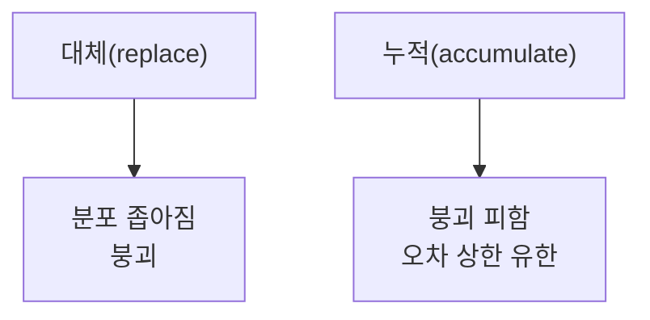

# AI 생성 글의 웹 오염

> 웹에 AI가 쓴 글이 늘면, 그 글이 **다음 세대 모델의 학습 데이터에 섞여 들어와** 분포가 좁아지는 문제가 생길 수 있다. 연구자들은 이를 "모델 붕괴(model collapse)"라 부르며, 조건에 따라 피할 수 있다고도 본다.

## 쉽게 말하면
복사본을 다시 복사하면 매번 조금씩 흐려지고 가장자리의 세부가 사라진다. 모델이 모델의 출력을 먹고 자라면 드문 표현과 희귀한 사실부터 사라지는 식이다. 원본을 계속 섞어 주면 덜 흐려진다.

## 자세히
- **붕괴 주장(Shumailov 외, "The Curse of Recursion", arXiv 2305.17493, 초록 직접 읽음)**: 모델이 생성한 내용으로 학습하면 모델에 되돌릴 수 없는 결함이 생긴다. 원 분포의 **꼬리(드문 부분)가 점점 사라진다**. VAE, 가우시안 혼합 모델, LLM에서 관찰되며 학습된 생성 모델에 널리 나타난다고 주장한다. (Nature 2024 게재판은 접근 제한으로 이번에 열지 못했다.)
- **반론·조건(Gerstgrasser 외, arXiv 2404.01413, 2024-04, 검색 결과 요약)**: 이전 연구는 세대마다 데이터를 **대체(replace)**한다고 가정했다. 합성 데이터를 원래 실제 데이터와 **누적(accumulate)**하면, 실험한 모든 모델·데이터에서 붕괴가 피해졌고 대체 시에는 모두 붕괴했다고 보고한다. 선형 모델 이론에서는 대체하면 오차가 반복 횟수에 따라 늘고, 누적하면 반복과 무관한 유한 상한이 있다. 다만 실제 웹 규모의 복잡성은 반영하지 못한다는 단서가 있다(검색 요약, 본문 미확인).
- **직접 실험(장난감, 가우시안 반복 적합)**: 세대마다 n=20개를 뽑아 평균·표준편차를 다시 적합하는 과정을 50세대 반복하고 400회 시행했다. **대체**하면 최종 표준편차의 중앙값이 **0.069**(원래 1.0), 10~90% 구간이 0.015~0.406으로 분포가 크게 좁아졌다. **누적**하면 중앙값 **0.927**, 구간 0.722~1.24로 거의 유지됐다. 이 모델은 매우 단순화한 가정이라 LLM에 그대로 적용되지 않고 "대체 vs 누적" 차이의 직관만 보여 준다.
- **실무 시사점(제안)**: ① 웹 크롤 연도별 AI 생성 글 비중 추정 ② 실제 사람이 쓴 데이터를 보존·표시(출처 기록) ③ 생성 데이터를 대체가 아닌 보충으로 쓰기 ④ 분포의 꼬리(전문 용어·소수 언어)를 따로 평가.
- 한계: 실제 웹에서 AI 글이 얼마나 되는지, 필터로 걸러지는지는 이 노드에서 확인하지 못했다.

## 그림으로 보기

## 예시
| 방식 | 최종 표준편차 중앙값(직접 실험, 원래 1.0) |
|---|---|
| 대체 | 0.069 |
| 누적 | 0.927 |
- 업무 장면: 사내 위키를 챗봇이 요약한 글로 계속 덮어쓰고 다시 학습하면 세부 정보가 사라질 수 있다. 원본 문서를 보존하고 요약본은 별도로 둔다.

## 헷갈리는 것과 비교
| 개념 | 차이 |
|---|---|
| 모델 붕괴 | 생성 데이터로 반복 학습해 분포가 좁아짐 |
| [기계 번역투](#mt-translationese) | 기계 번역 글이 만드는 문체 편향 |
| [패러프레이즈 다양성 쏠림](#paraphrase-diversity-collapse) | 증강 데이터가 비슷한 문체로 몰리는 문제 |
| 환각 | 개별 응답의 사실 오류. 분포 수준의 문제와 별개 |

## 더 읽을거리
- [The Curse of Recursion (arXiv 2305.17493)](https://arxiv.org/abs/2305.17493) — 모델 붕괴 최초 제안(초록 직접 읽음).
- [Is Model Collapse Inevitable? (arXiv 2404.01413)](https://arxiv.org/abs/2404.01413) — 대체 vs 누적(검색으로 요약 확인).
