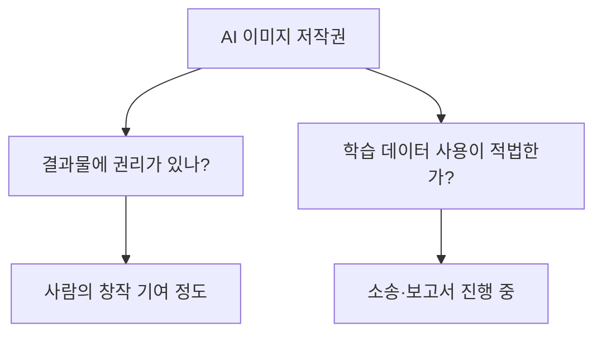
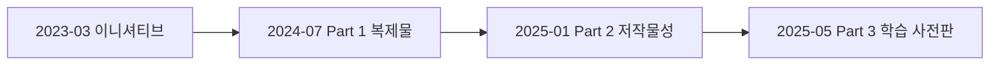

# AI 이미지 저작권

> AI 이미지 저작권은 두 쟁점이다. ① **AI가 만든 결과물에 저작권이 생기는가**(저작물성) ② **저작물을 학습에 쓰는 것이 적법한가**(학습). 나라마다 다르며 진행 중이다.

## 쉽게 말하면
카메라로 찍은 사진은 사진가의 작품이지만, 카메라가 알아서 만든 그림의 주인은 누구인가 하는 문제다. 그리고 그 카메라를 만들려고 남의 그림 수억 장을 보여 줬다면 그것은 괜찮은가 하는 문제가 따로 있다.

## 자세히
(미국 저작권청 AI 이니셔티브 페이지 확인 — 날짜 위주, 결론은 별도 확인 필요)
- **미국 저작권청 보고서 시리즈**: 2023-03-16 AI 이니셔티브 시작, 2023-08-30 의견 조회(1만 건 이상 의견), **Part 1 디지털 복제물 2024-07-31**(연방 디지털 복제물 법 권고), **Part 2 저작물성 2025-01-29**, **Part 3 생성형 AI 학습 사전 공개판 2025-05-09**(최종판 예정). 등록 안내(2023-03)와 *Zarya of the Dawn*, *SURYAST* 등 심사위원회 결정, *Thaler v. Perlmutter* 소송도 이 페이지에 링크돼 있다.
- Part 2의 구체적 결론(사람의 저작성 요구, 프롬프트만으로 부족 등)은 이 페이지에서 확인하지 못했다. 일반적으로 알려진 방향은 "사람의 창작적 기여가 있어야 보호"이지만 보고서 원문으로 확인해야 한다.
- 한국·EU·일본 법제는 이 글에서 다루지 않았다.
- 실무(권고): 상업 이미지는 생성 서비스 약관의 이용 권리 확인, 학습 데이터 출처 정책 확인, 실존 작가 스타일·상표 모방 피하기, 사람이 편집·배치한 기여를 기록.

## 그림으로 보기

## 예시
- 기업이 AI로 로고를 만들 때 서비스 약관의 상업 이용 조항과 상표 충돌 여부를 확인.
- 교육 자료에 생성 이미지를 쓸 때 "AI 생성" 표기와 출처 기록.

## 헷갈리는 것과 비교
| 개념 | 차이 |
|---|---|
| 결과물 저작물성 | 생성물이 보호받는가 |
| 학습 적법성 | 훈련 데이터 이용이 허용되는가 |
| 디지털 복제물 | 목소리·초상 복제(Part 1 주제) |
| [딥페이크](#deepfake) | 실존 인물 합성 |

## 더 읽을거리
- [U.S. Copyright Office: Copyright and Artificial Intelligence](https://www.copyright.gov/ai/)
