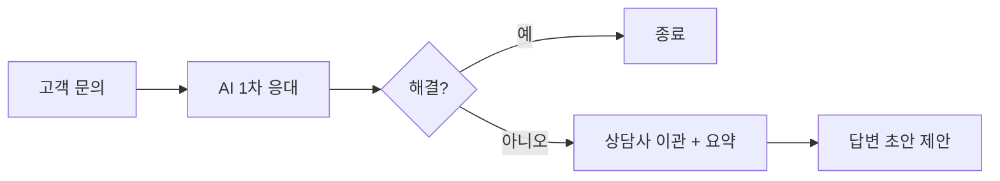

# 고객 지원 AI

> 챗봇이 문의를 직접 처리하거나, 상담사에게 답변 초안을 제안하는(agent assist) 방식의 AI. 사람과 섞을 때 효과 근거가 가장 단단하다.

## 쉽게 말하면
신입 상담사 옆에 베테랑의 노하우를 속삭여 주는 코치가 붙는 것(agent assist)과, 아예 창구를 로봇이 맡는 것(챗봇)의 두 길이다.

## 자세히
- **독립 연구**: NBER WP 31161(Brynjolfsson 외, 2023-04, 개정 2023-11, 이후 QJE 2025 게재). 생성형 AI 보조로 상담사 5,179명의 시간당 해결 건수 약 14% 증가, 초보·저숙련은 34%, 숙련자는 거의 변화 없음.
- **Klarna(2024-02-29 발표, 회사 보고)**: OpenAI 기반 어시스턴트가 채팅의 3분의 2 처리, 풀타임 700명분, 해결 11분→2분, 35개 언어·23개 시장. 2024년 4천만 달러 이익 개선은 *전망*이다. 한 달 운영 기준이고 감사받지 않았다. 검색 보도에 따르면 2025-05에 일부를 사람 상담으로 되돌렸다(원문 미확인).
- 교훈: 회사 발표 수치는 홍보일 수 있고, 사람 연계를 권고하는 분석(Gartner)이 있다.

## 그림으로 보기

## 예시
상담사 화면에 "이전 대화 요약 + 추천 답변"을 띄우고 상담사가 수정해 전송한다. 어려운 건은 사람에게 넘기는 규칙을 둔다.

## 헷갈리는 것과 비교
| 개념 | 차이 |
| --- | --- |
| 챗봇(대체) | 비용 절감 크지만 품질 위험 |
| agent assist(보조) | 초보 상담사 효과 큼 |
| [AI 도입 ROI](#ai-adoption-roi) | 이런 수치를 검증하는 방법 |

## 더 읽을거리
- [NBER: Generative AI at Work](https://www.nber.org/papers/w31161) — 5,179명 상담사 연구
- [CX Today: Klarna 발표](https://www.cxtoday.com/contact-center/klarna-claims-its-new-ai-assistant-does-the-work-of-700-full-time-agents/) — 회사 주장 수치와 인력 변화
