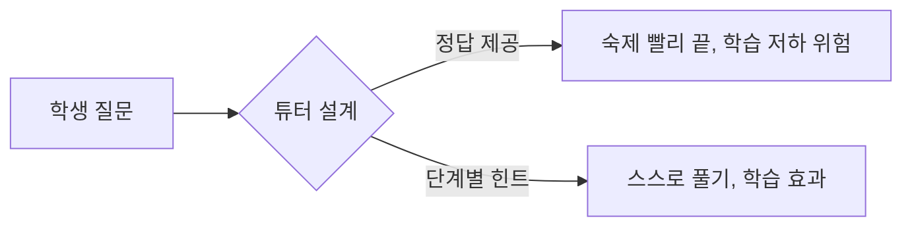

# 교육 AI

> 학생 질문에 맞춰 단계별로 가르치는 AI 튜터, 자동 채점 등. 설계에 따라 학습을 돕기도, 해치기도 한다.

## 쉽게 말하면
답을 알려 주는 조교와, 힌트만 주며 스스로 풀게 하는 조교의 차이다. 앞쪽은 숙제는 빨리 끝내도 실력이 안 는다.

## 자세히
(아래 연구 2건은 검색 요약 기준이며 논문 원문은 확인하지 못했다.)
- **Kestin 외, Scientific Reports 15권(2025-06-03)**: 하버드 입문 물리 194명, 맞춤 GPT-4 튜터 vs 수업 내 능동 학습 교차 실험. 사후 점수 중앙값 4.5 vs 3.5, 더 짧은 시간에 학습. 한 번에 한 단계씩 안내하도록 설계. 한계: 하버드 학생, 두 주제, 단기 시험.
- **Bastani 외, PNAS 122권(2025)**: 터키 고교생 약 1,000명. 가드레일 없는 GPT 사용 후 접근을 막자 접근한 적 없는 학생보다 17% 낮은 점수. 가드레일 있는 튜터는 피해를 대부분 완화.
- **규제**: EU AI Act 부속서 III 3항은 입학, 학습 성과 평가, 교육 수준 평가, 시험 부정행위 감독을 고위험으로 분류한다.
- Khanmigo·Bloom 2시그마 주장은 이번에 검증하지 못했다.

## 그림으로 보기

## 예시
시스템 프롬프트에 "정답을 직접 주지 말고 다음 한 단계만 질문으로 제시하라"를 넣고 교사가 대화 기록을 본다.

## 헷갈리는 것과 비교
| 개념 | 차이 |
| --- | --- |
| 가드레일 있는 튜터 | 학습 효과 근거 |
| 무제한 챗봇 | 의존 위험 |
| [AI 리터러시](#literacy) | 학습자가 AI를 이해하는 것 |

## 더 읽을거리
- [EU AI Act Annex III](https://artificialintelligenceact.eu/annex/3/) — 교육 분야 고위험 용도
