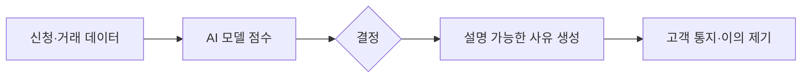

# 금융 AI

> 사기 탐지, 신용평가, 상담 자동화 등에 쓰이는 AI. 결정 이유를 설명해야 한다는 규제가 모델 선택을 좌우한다.

## 쉽게 말하면
은행 창구의 "대출 거절" 통보에는 이유가 적혀야 한다. 복잡한 AI가 판정했어도 마찬가지다.

## 자세히
- **CFPB Circular 2022-03(2022-05-26)**: 복잡한 "블랙박스" 알고리즘을 써도 채권자는 거절 시 구체적인 주된 사유를 통지해야 한다(ECOA/Regulation B). 자기 모델을 이해 못 한다는 건 면책 사유가 아니다.
- **EU AI Act 부속서 III 5(b)**: 개인의 신용도 평가·신용점수 산정용 AI는 고위험 시스템. 금융 사기 탐지용은 예외로 명시.
- 사기 탐지 효과: 미국 재무부가 2024-10-17 FY2024에 40억 달러 이상의 사기·부적정 지급을 예방·회수했다고 발표했고 ML이 일부 기여(언론 보도, 원문 미확인, 사기와 부적정 지급이 섞인 수치).
- 한국 규제(금융위·금감원)는 이번에 확인하지 못했다 → 추후 보강.

## 그림으로 보기

## 예시
신용 모델이 거절하면 "소득 대비 부채 비율이 높음" 같은 구체 사유를 제공해야 하므로, 사유 추출이 쉬운 모델(트리·SHAP 분석)이 선호된다.

## 헷갈리는 것과 비교
| 개념 | 차이 |
| --- | --- |
| 신용평가 AI | 고위험, 설명 의무 |
| 사기 탐지 AI | EU에서 고위험 예외 |
| [AI 거버넌스](#ai-safety) | 규제 전반 |

## 더 읽을거리
- [CFPB Circular 2022-03](https://www.consumerfinance.gov/compliance/circulars/circular-2022-03-adverse-action-notification-requirements-in-connection-with-credit-decisions-based-on-complex-algorithms/) — 블랙박스 모델과 거절 사유 통지
- [EU AI Act Annex III](https://artificialintelligenceact.eu/annex/3/) — 고위험 사용처 목록
