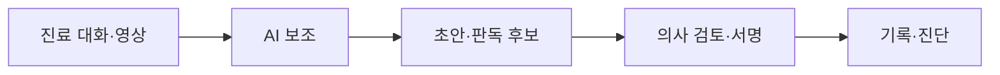

# 의료·헬스케어 AI

> 영상 판독 보조, 진료 기록 자동 작성(앰비언트 스크라이브) 등 의료 현장의 AI. 규제 기기로 관리되고 효과 근거가 도구마다 다르다.

## 쉽게 말하면
AI는 의사의 "두 번째 눈"과 "받아쓰기 비서"에 가깝다. 진단 책임은 여전히 사람에게 있다.

## 자세히
- **FDA AI 기기 목록**: 미국 FDA가 승인·허가한 AI 탑재 의료기기를 공개한다. 열어 본 범위에서 영상의학(radiology)이 가장 많았고, 최신 결정일은 2026-06-29였다. FDA는 현재 LLM·파운데이션 모델 기반 기기를 별도 표시하지 않으며 향후 식별 방안을 검토한다고 밝혔다.
- **앰비언트 스크라이브 연구(검색 요약, 원문 미확인)**: UCLA 무작위 시험(NEJM AI, 외래 의사 238명)에서 Nabla는 노트 작성 시간 9.5% 감소, Microsoft DAX Copilot은 유의한 변화 없음. 다른 단계적 도입 시험(66명)은 업무 소진 감소는 있었으나 직업 만족은 유의하지 않았다. 단일 기관·소규모이므로 일반화에 주의.
- 위험: 가끔 임상적으로 의미 있는 부정확한 기록, 환자 정보 보호, 책임 소재.

## 그림으로 보기

## 예시
진료 대화를 녹음하면 AI가 SOAP 노트 초안을 만들고, 의사가 고쳐 서명한다. 의사 검토 단계를 생략하면 오류가 기록에 남는다.

## 헷갈리는 것과 비교
| 개념 | 차이 |
| --- | --- |
| 판독 보조 AI | 규제 기기, 영상 중심 |
| 스크라이브 | 문서화 도구, 효과는 제품별로 다름 |
| [AI 안전·윤리](#ai-safety) | 위험·책임 일반론 |

## 더 읽을거리
- [FDA: AI-Enabled Medical Devices 목록](http://www.fda.gov/medical-devices/artificial-intelligence-enabled-medical-devices/list-artificial-intelligence-enabled-medical-devices) — 공식 목록과 LLM 표시 계획
