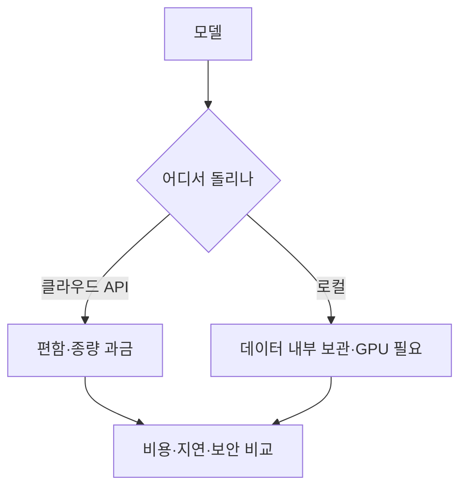

# AI 인프라·배포

> 모델을 실제로 돌리고 서비스로 내놓는 기반: 하드웨어(GPU), 실행 방식(API·로컬), 비용 구조, 배포.

## 쉽게 말하면
AI 모델이 요리사라면 인프라는 주방 설비와 가스·전기, 배달 체계다. 요리 실력이 좋아도 주방이 없거나 비용이 감당 안 되면 손님에게 못 낸다.

## 자세히
이 가지의 하위 주제:
- **하드웨어**: [GPU와 VRAM](#gpu-basics) — 모델이 메모리에 올라가야 돌아간다.
- **비용 구조**: [학습 vs 추론](#training-inference-cost) — 일회성 큰 비용 대 반복 비용.
- **줄이는 기법**: [양자화](#quantization), 캐싱, 배칭.
- **실행 방식 선택**: 클라우드 API([LLM API 기초](#llm-api-basics)) 대 내 컴퓨터에서 직접([로컬 LLM](#local-llm)).
- **선택 기준 4가지**: 비용, 지연 시간, 데이터 보안([개인정보와 저작권](#privacy-copyright)), 품질·모델 선택권.
- 연결된 웹 개발 기초: [프론트·백엔드](#frontend-backend), [환경 변수](#secrets-env).

## 그림으로 보기

## 예시
- 사내 문서 요약: 기밀이면 로컬 모델 또는 기업용 API 약관 확인, 아니면 API.
- 개인 실험: 8GB VRAM이면 양자화한 7~8B 모델을 로컬로.

## 헷갈리는 것과 비교
| 개념 | 차이 |
| --- | --- |
| 인프라 | 모델을 돌리는 기반 전체 |
| 모델 | 돌려지는 대상(가중치) |
| 배포 | 서비스로 내놓는 일 |

## 더 읽을거리
- [Navigating the high cost of AI compute (a16z)](https://a16z.com/navigating-the-high-cost-of-ai-compute/) — 컴퓨트 비용 구조
