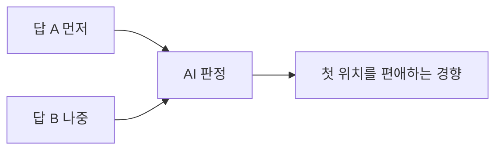
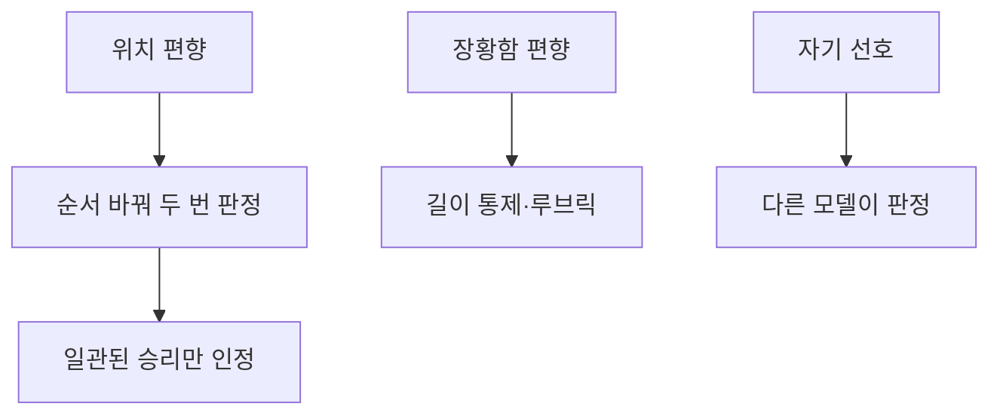

# AI 판정의 위치·길이 편향

> AI에게 "A와 B 중 어느 답이 더 낫나"를 시킬 때, 내용과 무관하게 먼저 나온 답(위치)이나 더 긴 답(장황함)을 편애하는 경향이다. AI 피드백 데이터와 LLM 평가의 대표적 약점이다.

## 쉽게 말하면
심사위원이 첫 번째 발표자에게 후한 점수를 주거나, 말이 긴 발표를 "성의 있다"고 느끼는 것과 같다. AI도 같은 착각을 한다.

## 자세히
(Zheng 외, "Judging LLM-as-a-Judge with MT-Bench and Chatbot Arena", arXiv 2306.05685 본문을 직접 읽고 확인.)
- **위치 편향**: 거의 같은 두 응답(GPT-3.5를 온도 0.7로 두 번 호출)을 순서만 바꿔 판정시켰더니 모든 판정 모델이 강한 위치 편향을 보였고 대부분 **첫 번째 위치를 선호**했다. 순서를 바꿔도 같은 결론을 내는 비율(일관성)이 **60%를 넘은 것은 GPT-4뿐**. Claude-v1은 "Assistant A"라는 이름을 선호하는 이름 편향도 보였다(이름을 바꿔 확인).
- **장황함 편향**: 내용 없이 목록 항목만 반복해 늘린 "repetitive list" 공격에 판정 실패율이 **Claude-v1 91.3%, GPT-3.5 91.3%, GPT-4 8.7%**(23개 답변 기준 소표본).
- **자기 선호**: 판정 모델이 자기가 생성한 답을 편애할 수 있다(자기 강화 편향, 통제 실험은 어렵다고 논문이 인정).
- **수학·추론 채점 한계**: 스스로 풀 수 있는 기초 수학 문제도 채점에서 틀리는 경우가 있다.
- **완화**: 두 답의 **순서를 바꿔 두 번 판정**하고 두 번 다 이긴 쪽만 승리로(불일치는 무승부), few-shot 예시(GPT-4 일관성 65.0%→77.5%이나 일관됨이 정확함을 뜻하지는 않음), 참조 답을 주거나 사고 과정 후 채점.
- **총괄**: GPT-4 판정이 사람 선호와 **80% 이상 일치**(사람끼리 일치도와 비슷)한다고 보고하면서도 이런 한계를 같이 밝혔다.

## 그림으로 보기

## 예시
- 신규 챗봇 A/B 비교에서 순서를 바꿔 두 번 판정하고 결과가 갈리면 사람이 본다.
- 교육 활용: "AI가 채점한 점수를 그대로 믿으면 안 되는 이유" 실습.

## 헷갈리는 것과 비교
| 개념 | 차이 |
|---|---|
| 위치 편향 | 순서에 따른 선호 |
| 장황함 편향 | 길이에 따른 선호 |
| [UltraFeedback](#ultrafeedback) | 이런 편향을 완화하려 한 AI 피드백 데이터셋 |

## 더 읽을거리
- [Judging LLM-as-a-Judge (arXiv 2306.05685)](https://arxiv.org/abs/2306.05685) — 위치·장황함·자기 선호 실험과 완화법.
