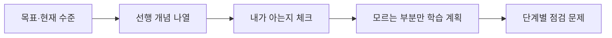
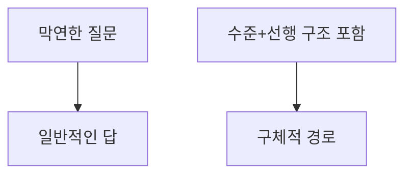

# AI로 학습 경로 만들기

> AI에게 **선행 개념을 먼저 묻고, 내 현재 수준에 맞춰 순서 있는 학습 계획**을 만들게 하는 프롬프트 방식. 개념 구조를 AI가 펼쳐 주면 막연한 "이거 알려 줘"보다 훨씬 구체적인 답이 나온다.

## 쉽게 말하면
등산 전에 지도와 코스표부터 받는 것이다. "산 위에 가고 싶어"라고만 하면 막막하지만, "지금 체력은 이 정도, 정상까지 거쳐야 할 구간은?"이라고 물으면 단계별 길이 나온다.

## 자세히
- 근거 1(구조가 있으면 답이 구체적): *Concept graphs with LLMs*(arXiv 2402.14293, 초록 읽음)는 LLM이 **제로샷으로 만든 개념 그래프**가 지도학습 방법과 대등하고(평균 F1 약 3% 향상), 개념 그래프를 활용한 파이프라인 CGLLM이 TutorQA(전문가 검증 NLP 벤치마크, 5과제·500문항)에서 최대 26% F1 향상, 사람 평가에서 더 세밀한 개념을 담았다고 보고했다.
- 근거 2(공백 확인은 구체 맥락): 켄트 대학 프롬프트 은행은 "나는 [학년/수준]이고 [주제]의 [개념]이 이해가 안 돼요. 본문을 참조해 쉬운 설명부터 해 주세요"라는 형식을 권한다. 핵심은 **모르는 것을 온전히 인정하고 기초부터 시작**하는 것, AI 요약은 **출발점**일 뿐 노트·교재와 비교하며 검증하는 것, 그리고 가르치며 배우기([AI를 학생으로](#explain-to-ai-student))를 병행하는 것. AI가 편향되거나 틀릴 수 있다는 경고도 있다.
- 프롬프트 설계(내 제안, 검증된 처방 아님):
  1. 목표와 현재 수준 제시 → 2. "먼저 선행 개념을 의존 순서로 나열" 요청 → 3. 내가 "알아/들어봄/처음"으로 표시 → 4. 모르는 것만 단계별 계획(주 단위, 자료, 확인 질문) → 5. 각 단계 끝에 이해 점검 문제.
- 한계: AI가 만든 선행 관계는 틀릴 수 있어 교재 목차·전문가와 교차 확인([선행 개념 그래프](#prerequisite-graph)).

## 그림으로 보기



## 예시
```text
나는 마케터이고 AI 기초는 모른다. 목표: 3주 안에 RAG 개념을 설명하는 것.
1) RAG를 이해하기 위한 선행 개념을 의존 순서로 나열해 줘.
2) 각 개념에 대해 아는지 모르는지 내가 답할 수 있게 한 줄 질문을 달아 줘.
```
- 교육: 수강생마다 다른 수준에 맞춘 학습 로드맵을 AI로 만들고 강사가 검수하는 흐름.

## 헷갈리는 것과 비교
| 개념 | 차이 |
|---|---|
| 학습 경로 프롬프트 | 선행 구조+수준 기반 계획 |
| 일반 질문 | 개념 설명만 요청 |
| [지식 추적](#knowledge-tracing) | 시스템이 학습자 상태를 자동 추정 |

## 더 읽을거리
- [Concept graphs with LLMs (arXiv 2402.14293)](https://arxiv.org/abs/2402.14293) — 개념 그래프와 TutorQA(초록 읽음).
- [Kent 프롬프트 은행](https://student.kent.ac.uk/studies/using-generative-ai-in-your-studies/prompt-bank/help-me-identify-what-i-don-t-understand) — 이해 안 되는 점 확인 프롬프트(읽음).
