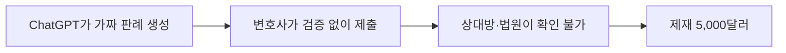
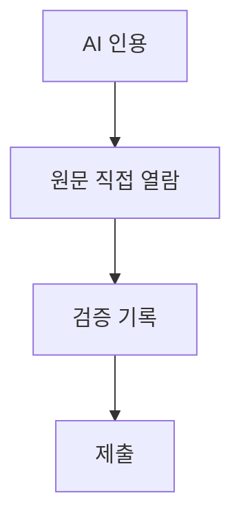

# AI 법률 서류 제재 사례

> 2023년 **Mata v. Avianca** 사건에서 변호사들이 ChatGPT가 만든 **존재하지 않는 판례**를 법원 서류에 인용했다가 **5,000달러** 제재를 받았다. AI 출력 검증 의무를 보여 주는 대표 사례다.

## 쉽게 말하면
AI가 그럴듯한 가짜 참고문헌을 만들어 내는데, 확인 없이 그대로 제출한 결과다. 도구를 썼다는 사실이 문제가 아니라 **확인하지 않은 책임**이 문제였다.

## 자세히
(Wikipedia "Mata v. Avianca, Inc." 확인 — 2차 자료, 원 판결문은 열지 않음)
- **사건**: 미 뉴욕 남부연방지방법원 No. 1:22-cv-01461. **2023-06-22** P. Kevin Castel 판사가 같은 날 두 가지 판단: 항공사의 소 각하 신청 인용(몬트리올 협약 시효 도과), 별도 제재 의견.
- **가짜 인용**: 원고 측 변호사들이 ChatGPT로 초안을 쓴 서류에 **다수의 존재하지 않는 판례**와 허구의 인용문이 들어 있었다. ChatGPT는 그 판례가 "실제로 존재한다"고 안심시켰다고 한다. 정확한 개수는 문서에 없다.
- **제재**: 변호사 Peter LoDuca, Steven A. Schwartz와 로펌 Levidow, Levidow & Oberman에 **연대하여 5,000달러**. 연방민사소송규칙 11조의 "주관적 악의"를 인정했는데, 인용이 의심받은 뒤에도 **끝까지 우긴(doubled down)** 점이 컸다.
- 법원은 AI 사용 자체를 금지하지 않았고 **기존 규칙**에 근거해 제재했다고 한다.
- **교훈**(권고): AI가 낸 인용·수치는 원출처로 직접 확인, 검증 기록 남기기, 의심을 받으면 즉시 정정.

## 그림으로 보기

## 예시
- 교육 활용: 수강생에게 AI가 제시한 참고문헌 5개를 원출처에서 찾아 확인하는 실습.
- 사내 정책: "AI가 준 인용·수치는 원문 링크 확인 후에만 문서에 사용".

## 헷갈리는 것과 비교
| 개념 | 차이 |
|---|---|
| 날조된 인용 | AI가 없는 출처를 만들어 냄 |
| 오인용 | 실제 출처의 내용을 잘못 요약 |
| [아첨 점검](#sycophancy-check) | AI의 동조 경향 점검 |
| 검증 체크리스트 | 사용 전 확인 절차 |

## 더 읽을거리
- [Mata v. Avianca, Inc. (Wikipedia)](https://en.wikipedia.org/wiki/Mata_v._Avianca,_Inc.)
