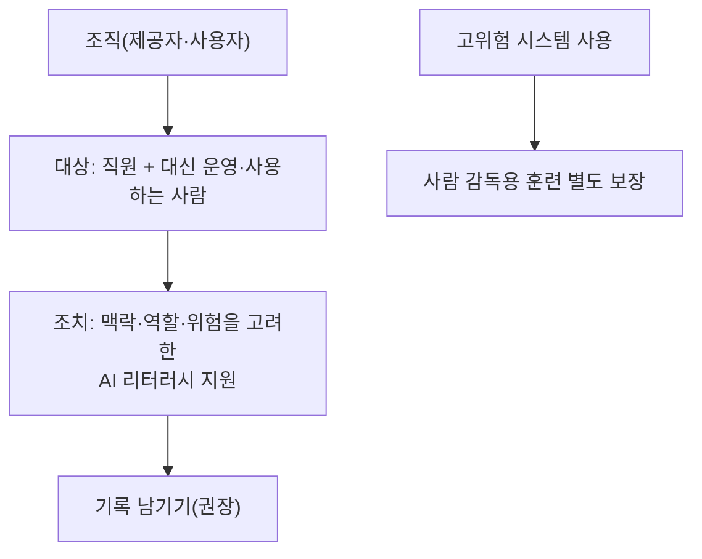
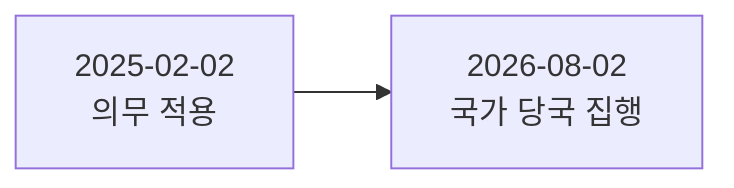

# AI 리터러시 의무

> EU AI Act의 **제4조**는 AI 시스템을 **제공하거나 사용하는 조직(provider·deployer)** 이 자기 직원과 대신 AI를 운영·사용하는 사람들의 **AI 리터러시를 높이는 조치**를 하도록 요구한다. **2025-02-02부터 적용**되고, 국가 감독 당국의 집행은 **2026-08-02부터**다. 정해진 교육 형식이나 자격증은 없다.

## 쉽게 말하면
회사가 자동차(AI)를 직원들에게 맡긴다면 "운전 면허증을 따라"까지는 아니어도, 맡은 일에 맞게 **기본 교육과 안전 수칙을 마련해 두라**는 요구다. 얼마나, 어떻게 하느냐는 회사 상황에 맞춰 판단한다.

## 자세히
(유럽연합 집행위원회 "AI literacy Q&A" 페이지 요약, 2026-11-25 확인. 법적 판단은 원문·전문가 확인 필요)
- **누가**: AI 시스템의 **제공자와 사용 조직(deployer)**. 대상은 직원뿐 아니라 **조직을 대신해 AI를 운영·사용하는 계약자·서비스 제공자·고객** 등도 포함한다.
- **무엇을**: 관련자의 **기술 지식·경험·교육·훈련**과 **AI가 쓰이는 맥락**을 고려해 AI 리터러시를 지원하는 조치를 취한다. 문서에 따르면 이 의무는 **개인의 지식을 측정하거나 특정 수준을 보장하라는 것이 아니며**, **디지털 옴니버스가 앞서 있던 "충분한(sufficient)" 수준 요구를 삭제했다**. 다만 **고위험 시스템 사용 조직은 사람 감독을 위한 직원 훈련**을 여전히 보장해야 한다.
- **형식**: **의무적인 교육 형식이나 인증서는 없다.** 내부적으로 훈련·활동 **기록**을 남길 수 있고, 시스템의 **사용 설명서에만 의존**하는 것은 보통 불충분하다고 본다.
- **고려 요소**: 조직의 역할(제공자/사용자), AI 시스템의 위험, 분야·사용 목적, 영향을 받는 사람들. **분야별 별도 요건은 없다.**
- **집행**: 2025-02-02부터 적용, **2026-08-02부터 국가 시장감시 당국이 제4조를 감독·집행**. 제재는 **국내법**에 따르며 비례적이어야 한다. AI Act 자체는 형사 처벌이나 보상 청구권을 만들지 않고, 피해 청구는 국내법 영역이다. 집행위는 AI 리터러시 **실천 사례 저장소**를 운영하지만 이를 따랐다고 자동으로 준수가 되는 것은 아니다.
- **교육 설계 시사점**(이 글의 정리):
  1. **역할별(개발·기획·인사·마케팅 등)** 로 필요한 내용을 달리한다.
  2. 위험이 큰 용도(채용·평가 등)를 다루는 사람은 **사람 감독과 한계 이해**를 더 깊게([AI Act 위험 등급](#ai-act-risk-tiers)).
  3. 교육 **기록**(일시·대상·내용)을 남긴다.
  4. 도구 사용 설명서 배포만으로 끝내지 않는다.
  5. 신규 도구 도입·정책 변경 시 **갱신 교육**.
- 한계: 이 글은 법률 자문이 아니다. 한국 조직도 EU 시장에 AI를 제공·사용하면 적용 대상일 수 있어 법무 확인이 필요하다.

## 그림으로 보기



## 예시
```markdown
# 사내 AI 리터러시 계획(예시)
| 대상 | 내용 | 방식 | 주기 | 기록 |
|---|---|---|---|---|
| 전 직원 | AI 기본 개념·한계·정보 보안 | 온라인 1시간 | 연 1회 | 수료 명단 |
| 인사팀 | 채용 AI의 위험·사람 감독 | 워크숍 | 도입 전·연 1회 | 자료·참석 |
| 개발팀 | 프롬프트 주입·권한 설계 | 실습 | 분기 | 과제 제출 |
```
- 교육 설계자 관점: 교육 소재와 기록 양식을 처음부터 한 세트로 설계하면 규정 대응이 쉬워진다.

## 헷갈리는 것과 비교
| 개념 | 차이 |
|---|---|
| AI 리터러시 의무 | 조직이 이해 수준을 높이는 **조치**를 취할 의무(측정·인증 요구 아님) |
| 사람 감독 훈련 | 고위험 시스템 사용 시의 별도 요구 |
| [AI Act 위험 등급](#ai-act-risk-tiers) | 용도에 따른 규제 강도 구분 |
| [AI 리터러시](#literacy) | 개념으로서의 AI 이해 능력 전반 |

## 더 읽을거리
- [European Commission: AI literacy — Questions & Answers](https://digital-strategy.ec.europa.eu/en/faqs/ai-literacy-questions-answers) — 제4조 해설과 집행 시점.
