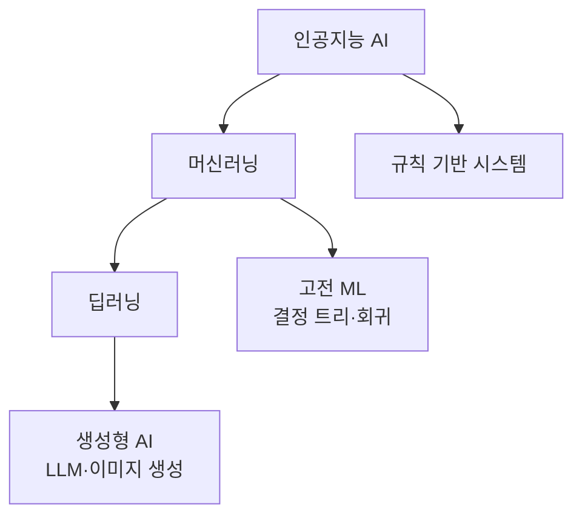

# AI·ML·DL의 관계

> 인공지능(AI) ⊃ 머신러닝(ML) ⊃ 딥러닝(DL) ⊃ 생성형 AI. 큰 상자 안에 작은 상자가 들어 있는 포함 관계다.

## 쉽게 말하면
"탈것 ⊃ 자동차 ⊃ 전기차 ⊃ 자율주행 전기차"와 같다. AI는 목적("사람의 지적 작업을 기계가"), ML은 방법("규칙을 직접 짜지 않고 데이터에서 배우게"), DL은 그중 한 기술("겹겹의 신경망"), 생성형 AI는 DL로 새 글·그림을 만들어 내는 응용이다.

## 자세히
IBM 설명 기준(2차 요약 포함):
- **AI**: 학습·추론·문제 해결 같은 인간 지능 작업을 하는 시스템 전반. 규칙 기반 전문가 시스템도 AI다.
- **머신러닝**: 데이터로 패턴을 배워 예측하는 방법. 사람이 특징(feature)을 설계하는 경우가 많다.
- **딥러닝**: 여러 층의 신경망을 쓰는 ML. 특징 설계를 줄여 이미지·음성·언어로 확장됐다.
- **생성형 AI**: 프롬프트에 응답해 텍스트·이미지·음성을 만드는 DL 모델. 그 바탕이 파운데이션 모델이다.
- 모든 AI가 ML은 아니고(규칙 기반), 모든 ML이 DL은 아니다(결정 트리, 선형 회귀).

## 그림으로 보기

## 예시
- 스팸 필터: 규칙("광고" 단어 포함이면 차단)은 AI, 메일 데이터로 학습한 분류기는 ML, 신경망 문장 이해 모델은 DL.
- ChatGPT·Claude는 생성형 AI이면서 DL이며 ML이며 AI다.

## 헷갈리는 것과 비교
| 개념 | 차이 |
| --- | --- |
| AI | 목표·분야 전체 |
| ML | 데이터로 배우는 방법 |
| DL | 신경망 기반 ML. [신경망 기초](#neural-network-basics) |
| 생성형 AI | 새 결과물을 만드는 DL 응용. [LLM 학습 단계](#llm-training-stages) |

## 더 읽을거리
- [What is artificial intelligence (IBM)](https://www.ibm.com/think/topics/artificial-intelligence) — AI·ML·DL·생성형 AI 포함 관계 설명
- [ML vs DL (IBM)](https://www.ibm.com/think/videos/machine-learning-vs-deep-learning) — 두 개념 비교
