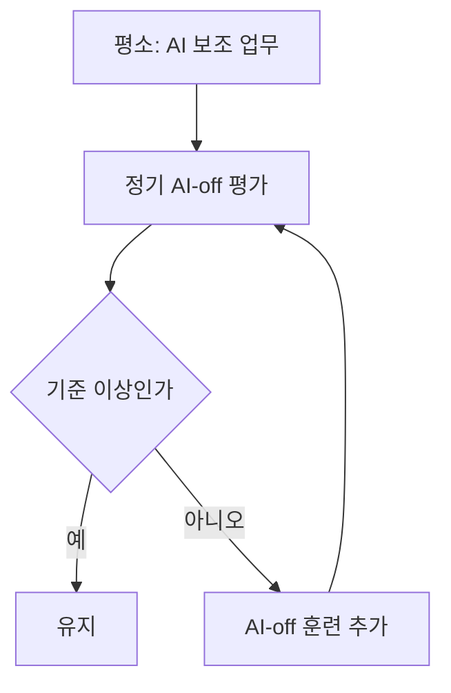
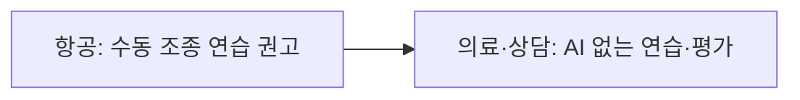

# AI 없는 훈련

> AI의 도움 없이 업무를 직접 수행하는 연습과 평가를 정기적으로 넣어 기본 역량이 녹슬지 않게 하는 방법. 항공 분야의 "수동 비행 연습" 권고가 오래된 선례이고, 의료·고객지원에서도 숙련도 저하 우려가 커지면서 같은 아이디어가 논의된다.

## 쉽게 말하면
자동 운전 기능만 쓰던 사람은 수동 운전이 서툴러진다. 그래서 일부러 가끔 수동으로 달려 보게 하는 연습 시간을 만든다. AI도 마찬가지다. 평소엔 AI와 같이 일하더라도, AI가 멈추거나 틀렸을 때 혼자 해낼 수 있는지 정기적으로 확인하고 연습해야 한다.

## 자세히
출처: Nicholas Carr의 2013년 글(FAA 자동화 보고서·SAFO 13002 해설, 직접 읽음), FAA 문서 관련 검색 결과 요약(FAA 원문은 열지 못함), Lancet 대장내시경 연구 전문가 반응(Science Media Centre, 직접 읽음). 항공 사례는 2차 출처이므로 인용 전에 FAA 원문을 대조해야 한다.
- **항공의 선례**: FAA는 2013년 1월 4일 안전 정보(SAFO 13002 "Manual Flight Operations")를 냈다. 검색 요약에 따르면 자동조종장치의 지속적 사용은 수동 조종 지식·기술을 강화하지 않으며, 운영사가 운항과 훈련(초기·승급·정기) 모두에서 수동 조종을 강조하는 통합 접근을 하고, 비행 부하가 낮은 상황 등에서 수동 조종 기회를 주도록 정책을 개발·점검하라고 권고한다. 법적 구속력은 없다(SAFO는 권고). 2017년 SAFO 17007이 후속 업데이트(검색 요약).
- **배경 보고서(Carr 글)**: FAA 연구진의 2001~2009년 사고·사건 검토에서 자동화 관련 문제가 큰 비중이었고, 최종 보고서(약 300쪽, WSJ가 검토한 초안 기준)는 과도한 의존이 수동 기술 저하, 판단력 약화, 자동화가 실패할 때의 자신감 저하를 낳는다고 서술했다. 승무원이 "시스템 관리자"로서 감시에만 익숙해진다는 지적도 있다.
- **감독의 한계(검색 요약)**: 미 교통부 감사실은 FAA가 조종사의 수동 조종 빈도를 파악하는 방법이 없다고 지적. 설문 응답자들은 정기 시뮬레이터 훈련의 85~95%가 자동화를 켠 채 이뤄진다고 보고(2차 출처, 미검증). 최근 훈련·자격 규칙은 균형 잡힌 자동화 관리와 수동 조종 훈련·확인을 요구하도록 확정됐다고 한다(검색 요약, 원문 미확인).
- **의료로의 확장**: 대장내시경 연구(Lancet Gastroenterol Hepatol 2025)가 AI 노출 후 AI 없는 검사 ADR이 낮아졌다고 보고하자 전문가들은 AI가 갑자기 쓰이지 않을 때(사이버 공격, IT 장애)의 성과를 평가해야 한다고 했다. 무작위 교차 시험과 장기 추적도 요구([관찰 연구와 인과](#observational-vs-causal)).
- **AI 없는 훈련 설계(이 글의 제안)**
  1. **정기 AI-off 평가**: 분기마다 AI 없이 대표 사례를 처리하고 성과를 기록.
  2. **훈련 비율 규정**: 신입은 일정 비율의 업무를 AI 없이 수행하며 이유를 설명하게 한다.
  3. **장애 대비 연습**: AI 서비스 중단 시 절차(수작업 체크리스트)를 모의 훈련.
  4. **성과 분리 기록**: AI 사용·미사용 건의 성과를 따로 기록해 변화를 추적([선종 발견율](#adenoma-detection-rate) 같은 지표).
  5. **강제 장치와 병행**: AI 추천 전에 먼저 판단하게 하는 설계([먼저 판단하고 AI 보기](#decide-first-then-ai)).
- **비용**: 업무 속도 저하와 반발이 있어 위험이 큰 직무부터 단계적으로 시행한다.

## 그림으로 보기

## 예시
- 법무팀: 분기마다 AI 요약 없이 신입 변호사가 계약서 위험 조항을 찾는 모의 평가를 실시하고, AI와 비교해 취약 영역을 보강(제안).
- 고객지원 센터: AI 추천 서비스 장애를 가정한 "수동 응대 훈련일"을 연 2회 운영(제안).

## 헷갈리는 것과 비교
| 개념 | 차이 |
|---|---|
| AI 없는 훈련 | 능력 유지를 위한 의도적 연습 |
| [인지적 강제 장치](#cognitive-forcing-function) | 평소 사용 중 생각을 유도하는 UI |
| [숙련도 저하](#deskilling) | 막으려는 위험 |
| 이중화(백업 절차) | 시스템 장애 시 대체 수단 마련 |

## 더 읽을거리
- [The FAA's automation report (Nicholas Carr, 2013)](https://www.roughtype.com/?p=4007) — FAA 연구·SAFO 해설(직접 읽음, 2차 출처)
- [Expert reaction to observational study ... colonoscopy (Science Media Centre)](https://www.sciencemediacentre.org/expert-reaction-to-observational-study-looking-at-detection-rate-of-precancerous-growths-in-colonoscopies-by-health-professionals-who-perform-them-before-and-after-the-routine-introduction-of-ai/) — AI 부재 시 성과 평가 요구(직접 읽음)
