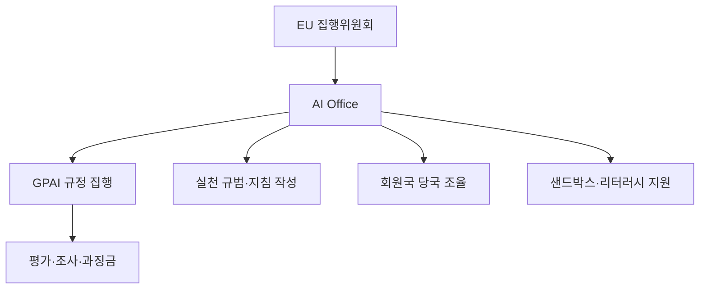

# EU AI Office

> EU 집행위원회 안에 있는 AI Act 이행·집행 조직. 특히 범용 AI(GPAI) 모델 규정을 직접 집행하고, 규범·지침을 만드는 중심이다.

## 쉽게 말하면
AI Act가 법전이라면 AI Office는 그 법을 현장에 적용하는 "전담 부서"다. 국가별 감독기관이 일반 AI를, AI Office가 거대 범용 모델을 주로 맡는 분업이다.

## 자세히
출처: 집행위 AI Office 소개 페이지(2026-11-15 확인).
- **역할**: AI Act 이행 지원, GPAI 규정 집행, 회원국 거버넌스 기구 자문, 신뢰할 수 있는 AI 생태계 육성, 국제 협력.
- **업무**: 회원국 간 일관된 적용, 평가 도구·벤치마크 개발, **시스템 리스크 모델 분류**, 실천 규범([GPAI 실천 규범](#gpai-code-of-practice)) 작성, 지침·시행령 준비, 샌드박스·실환경 시험·AI 리터러시 지원.
- **조직**: 직원 125명 이상(기술자·법률가·정책·경제학자). 6개 부서(AI·로보틱스 우수성, 규제·준수, AI 안전, 혁신·정책 조정, 사회적 선을 위한 AI, 보건·생명과학 AI)와 수석 과학 자문·국제 자문.
- **GPAI 집행 권한**: 모델 평가·위반 조사(점검, 기술 문서 요청), 정보·조치 요구, 모델 접근, 시정 조치 요구, 위반 시 모델의 공개 제공 제한과 직접 과징금 부과.
- 일정은 [시행 일정](#ai-act-enforcement-timeline), 과징금은 [과징금](#eu-ai-act-penalties) 참고.

## 그림으로 보기

## 예시
- 대형 모델 제공사가 기술 문서를 제출하지 않으면 AI Office가 정보 요청 → 시정 요구 → 과징금 순으로 대응할 수 있다.
- 기업 준수 담당자는 새 모델 출시 때 AI Office의 지침·FAQ를 먼저 확인한다.

## 헷갈리는 것과 비교
| 조직 | 역할 |
|---|---|
| AI Office | EU 차원, GPAI 집행 중심 |
| 회원국 감독기관 | 국가별 일반 AI 집행 |
| AI Board | 회원국 대표 협의체(자문·조율) |

## 더 읽을거리
- [European AI Office](https://digital-strategy.ec.europa.eu/en/policies/ai-office) — 공식 소개 페이지
