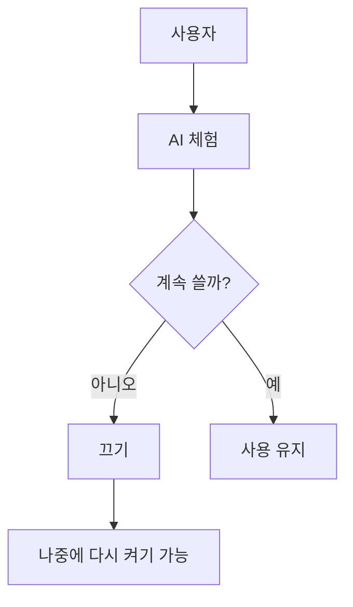

# AI 옵트아웃

> 사용자가 **AI 기능을 쓰지 않거나 꺼 둘 선택권**이며, 나중에 마음이 바뀌면 다시 켤 수 있어야 한다.

## 쉽게 말하면
식당이 "추천 메뉴 설명을 드릴까요?"라고 묻고 손님이 "괜찮아요"라고 하면 그대로 두는 것이다. 다음에 필요하면 다시 요청할 수 있어야 한다.

## 자세히
(Google PAIR "Feedback + Control" 챕터를 직접 읽었다.)
- **권고(PAIR)**: 사용자가 AI를 **시험해 보거나 끌 수** 있게 하는 것을 고려한다. 이점을 설명한 뒤에는 쓰지 않겠다는 선택을 **존중**한다. 가이드는 "나중에 쓰기로 결정할 수도 있다"고 적는다.
- **범위(PAIR)**: 암묵적 피드백 공유(행동 로깅)의 특정 부분만 끄는 기능별 옵트아웃, 그리고 AI를 완전히 끄거나 모델을 비개인화 기본값으로 되돌리는 더 넓은 통제가 있다. 데이터 수집 설정을 **맥락 안에서** 바꿀 수 있는 위치를 알려야 한다.
- **연관**: [수동 대안](#manual-fallback), [개인화 초기화](#personalization-reset).
- **한계(해석)**: 옵트아웃 시 기능이 얼마나 줄어드는지 미리 보여 주는 것이 사용자의 선택을 돕는다.

## 그림으로 보기

## 예시
- 사내 문서 도구의 "AI 제안" 토글을 설정 첫 화면에 두고, 끈 뒤에도 같은 위치에서 켤 수 있게 한다(제안).

## 헷갈리는 것과 비교
| 개념 | 차이 |
|---|---|
| AI 옵트아웃 | AI 사용 자체를 끔 |
| [개인화 초기화](#personalization-reset) | 학습한 취향만 지움 |
| [수동 대안](#manual-fallback) | 자동 실패 시 수동 경로 |

## 더 읽을거리
- [Google PAIR — Feedback + Control](https://pair.withgoogle.com/chapter/feedback-controls/) — 직접 읽음.
