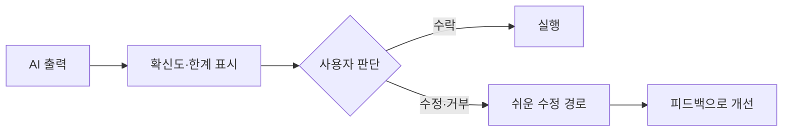

# AI 제품 설계(UX)

> AI의 불확실한 출력을 사용자가 이해하고 고치고 거부할 수 있게 만드는 인터페이스 설계. Microsoft HAX 18개 지침과 Google PAIR 가이드가 대표적이다.

## 쉽게 말하면
내비게이션이 "여기서 우회전"만 말하면 틀릴 때 속수무책이다. "이 경로는 70% 확신, 다른 경로 보기"를 주면 사용자가 판단하고 되돌릴 수 있다.

## 자세히
- **Microsoft HAX 'Guidelines for Human-AI Interaction'**(CHI 2019, Honorable Mention) 18개 지침 — 4단계: 처음 / 상호작용 중 / 틀렸을 때 / 시간이 지나며. 지침 제목: G1 할 수 있는 일을 분명히, G2 얼마나 잘하는지 분명히, G3 맥락에 맞는 시점, G4 맥락상 관련 정보 표시, G5 사회 규범 존중, G6 사회적 편향 완화, G7 쉬운 호출, G8 쉬운 닫기, G9 쉬운 수정, G10 불확실하면 범위 축소, G11 왜 그랬는지 설명, G12 최근 상호작용 기억, G13 사용자 행동에서 학습, G14 조심스러운 업데이트, G15 세분화된 피드백, G16 행동의 결과 전달, G17 전역 제어, G18 변경 알림. (단계별 묶음은 일부만 확인했다.)
- **Google PAIR(심성 모델 장)**: 적응 기대 설정, 단계적 온보딩, "AI 마법" 문구 피하기, 공동 학습 계획(어떤 신호로 개인화하는지 공개, 실패 시 비AI 기본 경로), 알고리즘임을 밝히고 초인적 능력을 암시하지 않기.
- **Google PAIR(오류 장)**: 오류를 사용자 관점에서 정의, 위험도(초보자·낮은 확신·건강·안전·금융에서 높음)와 시점 고려, 알려지지 않은 미지(unknown unknowns) 테스트, 앞으로 갈 길 제공(가장 쉬운 길은 사용자가 직접 맡는 것), 겸손한 표현.

## 그림으로 보기

## 예시
메일 답장 초안 기능: 초안은 "제안"으로 표시, 한 번에 지우기(G8), 문장 단위 수정(G9), "왜 이 표현?" 설명(G11), 보낸 뒤 학습 여부를 설정에서 끄기(G17).

## 헷갈리는 것과 비교
| 개념 | 차이 |
| --- | --- |
| HAX | 18개 지침, 인터랙션 중심 |
| PAIR | 챕터형 가이드북, 심성 모델·오류·피드백 |
| [AI 도입 ROI](#ai-adoption-roi) | 도입 효과 측정, UX와 상호 보완 |

## 더 읽을거리
- [Microsoft HAX Toolkit: 지침 라이브러리](https://www.microsoft.com/en-us/haxtoolkit/library/) — 18개 지침 제목
- [Guidelines for Human-AI Interaction (CHI 2019)](https://www.microsoft.com/en-us/research/publication/guidelines-for-human-ai-interaction/) — 논문
- [PAIR: Mental Models](https://pair.withgoogle.com/chapter/mental-models/) — 기대 설정·온보딩
- [PAIR: Errors + Graceful Failure](https://pair.withgoogle.com/chapter/errors-failing/) — 오류 설계
