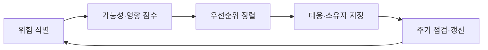
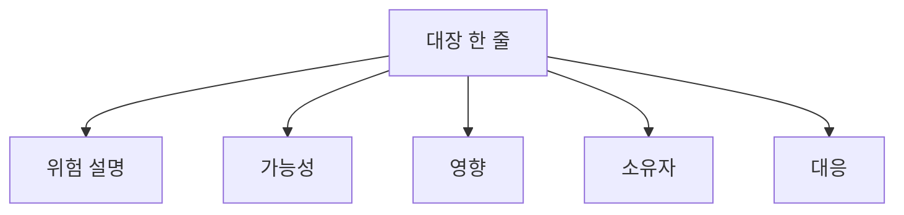

# AI 위험 대장

> 식별한 AI 위험을 **한 표에 기록하고 점수를 매겨 책임자·대응·점검 주기까지 추적**하는 목록. 위험 관리를 "한 번 하는 회의"가 아니라 "계속 갱신되는 문서"로 만든다.

## 쉽게 말하면
집 수리 목록과 같다. "지붕 누수: 가능성 높음, 피해 큼, 담당 아빠, 다음 달 수리"처럼 적어 두고, 급한 것부터 처리하며 계속 고친다.

## 자세히
- 개념 근거(NIST AI RMF 1.0, NIST AI 100-1): 위험을 **피해의 크기**와 **발생 가능성**의 함수로 본다. 그래서 대장의 핵심 열은 영향(impact)과 가능성(likelihood)이다.
- 공식 서식은 없다: 검색으로 확인한 범위에서 NIST의 정해진 템플릿은 찾지 못했다. 제3자 가이드(CASRAI)는 한 번의 검토 주기를 넘겨 살아남는 대장이 보통 가능성·영향·**소유자**·**대응 방안**·점검 주기를 갖는다고 설명한다(가이드 텍스트에 깨진 부분이 있어 주의).
- 권장 방식: 가능성과 영향을 따로 점수화한 뒤 일관된 방식으로 합쳐 정렬한다. NIST Playbook의 MANAGE는 문서화된 위험을 영향·가능성·가용 자원 순으로 우선 처리하라고 한다.
- AI RMF의 기능(Govern·Map·Measure·Manage) 중 Measure는 점수와 근거에, Manage는 대응과 주기에 대응시켜 볼 수 있다(해석).
- 갱신 주의: NIST가 AI RMF 1.0 개정을 진행 중이라고 밝혔으므로 현행 문구를 확인한다.

## 그림으로 보기

## 예시
| 위험 | 가능성 | 영향 | 소유자 | 대응 |
|---|---|---|---|---|
| 챗봇이 고객정보를 답함 | 중 | 높음 | 보안팀 | 출력 필터·접근 제한 |
- 교육: 사내 AI 도입 워크숍에서 위험 5개를 직접 채워 보는 실습.

## 헷갈리는 것과 비교
| 개념 | 차이 |
|---|---|
| 위험 대장 | 위험을 기록·추적하는 표 |
| 위험 평가 | 위험 수준을 판단하는 활동 |
| [위험 점수화](#risk-scoring) | 대장의 정렬 기준 |

## 더 읽을거리
- [NIST AI RMF 지식베이스](https://airc.nist.gov/AI_RMF_Knowledge_Base) — 공식 프레임워크(검색 결과 확인).
- [CASRAI: AI risk register 가이드](https://casrai.org/guides/ai-risk-assessment-framework-risk-register) — 제3자 가이드(검색 요약).
