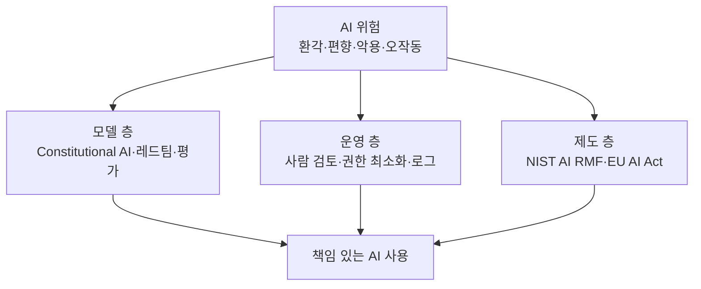
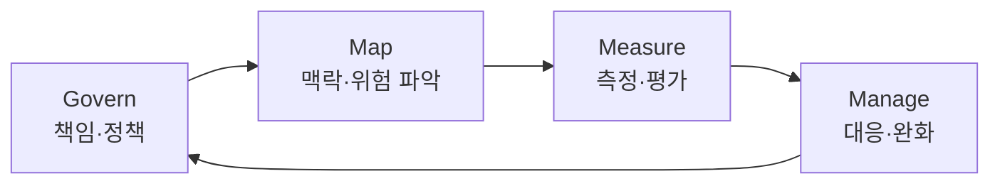

# AI 안전·윤리·거버넌스

> AI가 틀리거나, 편향되거나, 나쁜 일에 쓰이는 위험을 줄이고 책임 있게 쓰기 위한 원칙·기법·제도의 묶음.

## 쉽게 말하면
자동차에 비유하면 AI 성능은 엔진이고, AI 안전은 브레이크·안전벨트·교통법규다. 엔진이 세질수록 브레이크와 법규도 같이 발전해야 한다. 기술팀은 "모델이 위험한 답을 하지 않게" 만들고(기법), 회사는 "누가 책임지고 어떻게 점검하나"를 정하고(거버넌스), 국가는 "이런 용도는 금지, 이런 용도는 엄격 관리"를 정한다(규제). 세 층이 함께 있어야 한다.

## 자세히
세 층으로 나눠 보면 이해가 쉽다.

- **모델 층(기법)**: 학습 단계에서 위험한 답을 줄인다. 예) Anthropic의 **Constitutional AI**(2022): 사람이 해로운 답을 일일이 표시하는 대신, 짧은 원칙 목록("헌법")에 비추어 모델이 스스로 답을 비판·수정하고(지도학습), AI 심사위원의 선호로 보상 모델을 만들어 강화학습한다(RLAIF). 단순 거부보다 "왜 도울 수 없는지 설명"하는 쪽을 노린다. 그 밖에 레드팀(일부러 공격해 약점 찾기), 안전 평가, 출력 필터가 있다.
- **제품·조직 층(운영)**: 사람의 검토(human-in-the-loop), 권한 최소화, 로그, 프롬프트 인젝션 방어, 환각 점검([환각](#hallucination)). 에이전트가 코드를 실행하는 경우 샌드박스와 승인 단계가 핵심이다([바이브코딩 안전](#vibecoding-safety)).
- **사회·제도 층(규제·표준)**:
  - **NIST AI RMF**(미국, 2023-01-26 공개, 자발적 지침): Govern·Map·Measure·Manage 네 기능을 순환시킨다. 생성형 AI 프로파일 NIST-AI-600-1은 2024-07-26 공개. 현재 개정 작업 중이라고 NIST 페이지에 적혀 있다.
  - **EU AI Act**(법적 구속력): 위험 등급별 규제 — 금지(사회적 점수제 등), 고위험(채용·교육·신용평가 등, 엄격한 의무), 투명성 의무(챗봇임을 알리기·AI 생성물 표시), 최소 위험(규제 없음). 2025-02-02 금지·AI 리터러시 의무 적용, 2025-08-02 범용 AI(GPAI) 의무 적용, 2026-08-02 전반 적용. AI Omnibus(2026-07-27 발효)로 고위험 규칙은 Annex III 2027-12-02, 제품 내장형 2028-08-02로 미뤄졌다(EU 집행위 페이지, 확인 2026-10-30).

핵심 위험 유형: 환각(그럴듯한 오답), 편향·차별, 프라이버시 유출, 악용(사기·딥페이크), 에이전트의 의도치 않은 행동, 통제 불능(정렬 문제).

## 그림으로 보기

## 예시
- 사내 챗봇 도입: 어떤 질문엔 사람에게 넘기기(고위험 판단), 답에 근거 문서를 붙이기, 대화 로그 점검 주기 정하기 → NIST의 Map·Manage에 해당.
- 채용 서류 선별에 AI를 쓰면 EU AI Act에서 고위험 분류 대상(고용 분야)이다. 데이터 품질·사람 감독·기록 의무가 따른다.

## 헷갈리는 것과 비교
| 개념 | 차이 |
|---|---|
| AI 안전(safety) | 오작동·통제 불능·재앙 위험을 줄이는 기술적 관점 |
| AI 보안(security) | 해킹·프롬프트 인젝션 등 공격으로부터 시스템 보호 |
| AI 윤리 | 공정성·투명성 등 가치 판단 ([편향과 윤리](#ai-bias-ethics)) |
| 거버넌스 | 조직·국가가 책임·절차를 정하는 체계 |
| NIST AI RMF vs EU AI Act | 자발적 지침 vs 법적 의무 |

## 더 읽을거리
- [NIST AI Risk Management Framework](https://www.nist.gov/itl/ai-risk-management-framework) — 네 기능과 생성형 AI 프로파일.
- [EU AI Act 규제 틀](https://digital-strategy.ec.europa.eu/en/policies/regulatory-framework-ai) — 위험 등급과 적용 일정.
- [Constitutional AI (Anthropic)](https://www.anthropic.com/news/constitutional-ai-harmlessness-from-ai-feedback) — 원칙 기반 학습 방식.
